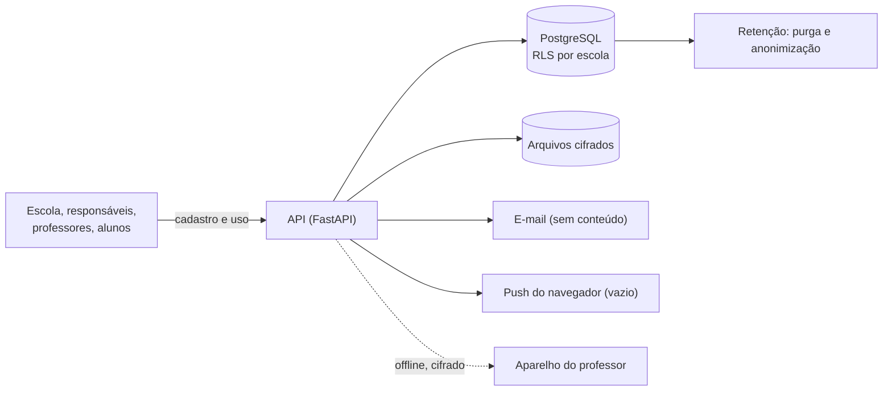

# RIPD — Relatório de Impacto à Proteção de Dados Pessoais (rascunho)

> **Rascunho técnico, não é parecer jurídico.** ⏸ Checkpoint: parecer do encarregado, revisão do jurídico e aprovação da escola antes de virar versão final. Modelo: skill `lgpd-ripd` (goul4rt/lgpd-skills, MIT). A regulamentação específica do RIPD ainda não foi publicada pela ANPD (segundo a skill): usamos o art. 38 da LGPD e o art. 4º da Res. CD/ANPD nº 2/2022, a **conferir no texto oficial**.

| Campo | Valor |
|---|---|
| **Atividades cobertas** | A002, A004, A005, A006, A011, A012 e as demais que tratam alunos ([ROPA](./ROPA.md)) |
| **Natureza** | **Alto risco por precaução.** Tratamos dado sensível (saúde) e dado de crianças e adolescentes (critério específico IV). O critério geral (larga escala ou afetação significativa de direitos) será confirmado conforme o porte de cada escola e o parecer; até lá, trata-se como alto risco |
| **Controladora** | A escola `{razão social, CNPJ}` |
| **Operadora** | `CADERNETA_OPERADORA_NOME` |
| **Encarregado** | Informado em *Escola* no app |
| **Versão** | v0.1 (rascunho) · 2026-11-17 |

## 1. Resumo

A Caderneta guarda notas, frequência, mensagens, anotações e a ficha de saúde de crianças e adolescentes, e dá acesso a professores, equipe e famílias. Os principais riscos são **acesso além do necessário** (por pessoa de dentro ou por conta invadida), **vazamento de dados de menores e de saúde** e **texto livre** que pode conter dado sensível. Os controles principais estão implementados (isolamento por escola no banco, papéis e vínculos, cifra da saúde e dos arquivos, auditoria, 2FA da equipe, limites de taxa, retenção automática). **Risco residual:** baixo a médio, com **3 pontos que dependem de decisão jurídica ou da implantação** (R14, R15 e a base legal de saúde). Não há inteligência artificial nem decisão automatizada.

## 2. Descrição do tratamento

- **Titulares:** alunos (crianças e adolescentes), responsáveis, professores e equipe.
- **Dados comuns e sensíveis:** ver [mapa de dados](./data-map.md). **Sensível:** ficha de saúde e, possivelmente, texto livre e anexos.
- **Sistemas:** banco PostgreSQL, diretório de arquivos cifrados, e-mail (SMTP), push dos navegadores, aparelho do professor (modo offline).
- **Sem IA, sem decisões unicamente automatizadas (art. 20), sem vigilância, sem publicidade, sem venda de dados.**

## 3. Necessidade e proporcionalidade (art. 6º)

| Princípio | Evidência |
|---|---|
| I Finalidade | Cada operação tem finalidade escolar determinada ([ROPA](./ROPA.md)); política de privacidade em linguagem simples |
| II Adequação | O uso dos dados segue o contexto informado: serviço escolar contratado pela escola |
| III Necessidade | CPF do aluno opcional; saúde só o que a escola preenche; professor vê só o alerta; e-mail e push sem conteúdo; modo offline só notas e chamada |
| IV Livre acesso | *Meus dados*: baixar uma cópia na hora; pedidos com prazo de 15 dias |
| V Qualidade | Correção por pedido; histórico emitido com código de conferência |
| VI Transparência | Política de privacidade e termos públicos; encarregado informado; ciência registrada por versão |
| VII Segurança | Ver seção 6 |
| VIII Prevenção | Revisão de segurança (M8.1), testes de isolamento e de permissões, este RIPD |
| IX Não discriminação | Sem decisão automatizada; sem perfis; notas só calculadas por regra aberta da escola |
| X Responsabilização | Auditoria de ações sensíveis, ROPA, RIPD, registro de pedidos, plano de incidentes |

**Alternativas menos intrusivas consideradas:** não guardar saúde na plataforma (a escola usaria papel, o que é pior para a segurança); campo de saúde em texto livre (descartado: estruturado e cifrado); e-mail com conteúdo (descartado: só avisa).

## 4. Base legal e direitos

- **Contrato com a escola** (art. 7º, V) e **obrigação legal escolar** (art. 7º, II) para a vida escolar; **segurança** (art. 7º, IX e art. 46) para a conta.
- **Saúde:** [BASE A DEFINIR NO PARECER: art. 11, I (consentimento específico e destacado de um dos pais) ou art. 11, II, "e" para o alerta de emergência; a alínea "f" não serve à escola] (T30).
- **Crianças e adolescentes:** melhor interesse (art. 14 e ECA Digital); **a escola pode criar conta de aluno de qualquer idade**: consentimento específico de um dos pais para crianças a confirmar no parecer (T30).
- **Direitos (arts. 18 e 19):** acesso e portabilidade imediatos em *Meus dados*; correção, eliminação e informação por pedido, respondido pela direção em até 15 dias ([Direitos do titular](../website/docs/funcionalidades/direitos-do-titular.md)). Art. 20: não se aplica.

## 5. Riscos (modelagem LINDDUN) e matriz

Escala: probabilidade (P) e impacto (I) de 1 a 5; nível = P×I (até 4 baixo, 5 a 9 médio, 10 ou mais alto). O risco residual considera os controles **já implementados**.

| ID | Risco | Categoria | P | I | Nível | Controles | Residual |
|---|---|---|---|---|---|---|---|
| R01 | Pessoa de dentro (professor, equipe) vê dado além do necessário | Disclosure | 3 | 4 | 12 | Papéis e vínculos, RLS, só ano letivo aberto, professor só vê alerta de saúde, leitura de saúde e anotação reservada auditadas | 6 médio |
| R02 | Banco, backup ou arquivos copiados (dados de menores) | Disclosure | 2 | 5 | 10 | TLS, saúde e arquivos cifrados (AES-GCM), RLS, papel do app sem posse das tabelas. Backups cifrados com teste de restauração e rotação de chave (M8.5); **falta rodar na hospedagem real** | 4 baixo |
| R03 | Atestado ou laudo anexado em mensagem expõe saúde | Disclosure | 3 | 4 | 12 | Anexos cifrados e com antivírus, sem EXIF, retenção 365 dias, e-mail sem conteúdo. **Base legal pendente** | 6 médio |
| R04 | Texto livre (anotações, mensagens, justificativas) com dado sensível ou conflito entre alunos | Non-compliance | 3 | 4 | 12 | Visibilidade por tipo, reservada só da equipe e auditada, versões, orientação aos professores nos termos | 6 médio |
| R05 | Conta invadida (senha fraca, phishing) | Identifying | 3 | 4 | 12 | Argon2id, 2FA da equipe, limite de taxa, bloqueio, código TOTP de uso único, sair de todos os aparelhos. **Professores sem 2FA (decisão T27)** | 6 médio |
| R06 | Celular de professor perdido com dados offline | Disclosure | 3 | 3 | 9 | Cofre cifrado com chave não exportável, apagado em 7 dias, ao sair e por *sair de todos*. A cifra não vale com o celular desbloqueado | 4 baixo |
| R07 | E-mail ou push revela conteúdo | Disclosure | 2 | 3 | 6 | Sem conteúdo, só adultos, horário silencioso | 2 baixo |
| R08 | Re-identificação ou inferência por metadados (frequência, endereço de push) | Linking | 2 | 2 | 4 | Push só de adultos; sem rastreadores; iCal sem nomes | 2 baixo |
| R09 | Guardar dados além do necessário | Non-compliance | 3 | 3 | 9 | Purga automática de desligados com aviso, retenção de arquivos e notificações, pedidos 5 anos. **Prazos a validar (T23) e backups (T24)** | 4 baixo |
| R10 | Responsável sem direito (guarda, restrição) acessa dados do aluno | Identifying | 3 | 4 | 12 | Vínculo **restrito**, "pode buscar", convite com hash; depende de a escola manter o cadastro | 6 médio |
| R11 | Falha de isolamento entre escolas | Disclosure | 1 | 5 | 5 | RLS no banco, testes de isolamento e de permissões, teste que percorre todas as rotas. **Teste de intrusão por terceiro pendente** | 5 médio |
| R12 | Link secreto ou público divulgado (iCal, conferência de histórico) | Disclosure | 2 | 2 | 4 | Token com hash, revogável; conferência devolve só iniciais; limite de taxa | 2 baixo |
| R13 | Pedido de titular não atendido no prazo | Non-compliance | 3 | 3 | 9 | Fila com prazo e selo de vencido, notificação à direção | 3 baixo |
| R14 | **Conta de criança sem consentimento parental registrado** | Non-compliance | 3 | 4 | 12 | Contas de alunos sem e-mail nem push, responsável vê tudo. **Consentimento a definir (T30)** | **9 médio, depende do parecer** |
| R15 | **Provedores e transferência internacional indefinidos** | Non-compliance | 3 | 3 | 9 | Push sem conteúdo; hospedagem ainda não escolhida (O8) | **9 médio, depende da implantação** |
| R16 | Erro nos dados do histórico emitido | Unawareness | 2 | 3 | 6 | Código de conferência, correção auditada, período fechado | 3 baixo |
| R17 | Incidente sem detecção ou resposta a tempo | Non-compliance | 3 | 4 | 12 | Auditoria; plano de resposta e ferramenta de contenção (M8.4). **Monitoramento e simulação ainda não existem (T33, T35)** | 6 médio |

**Conclusão provisória:** nenhum risco residual **alto**. Os riscos **médios** vêm de pessoas e processos (R01, R04, R05, R10, R17), do que depende de implantação (R02, R15) e de decisão jurídica (R03, R14). O risco só se aceita **depois** do parecer do encarregado e da aprovação da escola.

## 6. Salvaguardas verificadas no código

- [x] TLS na implantação (cookie `Secure` e HSTS obrigatórios em produção)
- [x] Cifra em nível de aplicação para saúde e arquivos (AES-GCM com contexto por registro)
- [x] **Backups cifrados com teste de restauração** (M8.5); cifra de volume é da hospedagem (M9)
- [x] **Rotação de chave** de dados (M8.5)
- [x] Menor privilégio por papel e vínculo; RLS por escola; papel do app sem posse das tabelas
- [x] 2FA obrigatório para a equipe; limite de taxa; código TOTP de uso único; troca de senha e *sair de todos*
- [x] Auditoria só de inserção; leitura de saúde e anotação reservada registradas
- [x] Retenção e eliminação automáticas; aviso antes de apagar desligados
- [x] Direitos do titular (M8.2) e transparência (M8.3)
- [x] Plano de resposta a incidentes e ferramenta de contenção (M8.4)
- [ ] Teste de intrusão por terceiro; monitoramento e alertas; simulação de incidente

## 7. ECA Digital (avaliação de impacto à segurança de crianças e adolescentes)

A skill indica que plataformas sujeitas ao ECA Digital devem avaliar também os riscos de **design**, não só de dados (Lei nº 15.211/2025, art. 16, parágrafo único, segundo a skill; **conferir no texto oficial**). Avaliação preliminar:

- **Contato com desconhecidos:** não há conversa entre alunos nem com pessoas de fora da escola. As mensagens são entre equipe e responsáveis.
- **Uso compulsivo:** não há feed, ranking, recompensas ou notificações por engajamento. O push só avisa novidade, sem conteúdo.
- **Recomendação ou perfilamento:** não há.
- **Publicidade e venda de dados:** não há.
- **Supervisão parental:** o responsável vê os dados do filho e pode fazer pedidos por ele.
- **Aferição de idade:** não se aplica; a conta nasce por convite da escola.

**Versão resumida em linguagem clara:** a política de privacidade já cobre os pontos essenciais; o resumo público específico (Decreto nº 12.880/2026, art. 47, § 1º, segundo a skill) fica para o parecer (T30).

## 8. Pareceres e aprovação ⏸

- **Decisões do responsável (2026-11-17):** confirmou (a) os papéis de controladora e operadora, (b) o regime padrão, (c) a **aceitação provisória dos riscos médios** R05 (professores sem 2FA), R10 (responsável sem direito, depende do cadastro da escola) e R14 (conta de criança sem consentimento parental registrado) até o parecer, e (d) o compromisso de **não** haver IA, perfilamento, publicidade, venda de dados, ranking nem conversa entre alunos (se isso mudar, refazer este RIPD).
- **Parecer do encarregado:** `{pendente}`
- **Revisão jurídica:** `{pendente}`
- **Aprovação da escola (controladora):** `{pendente}`
- **Revisão periódica:** a cada 6 meses ou a cada recurso novo com dado pessoal.
