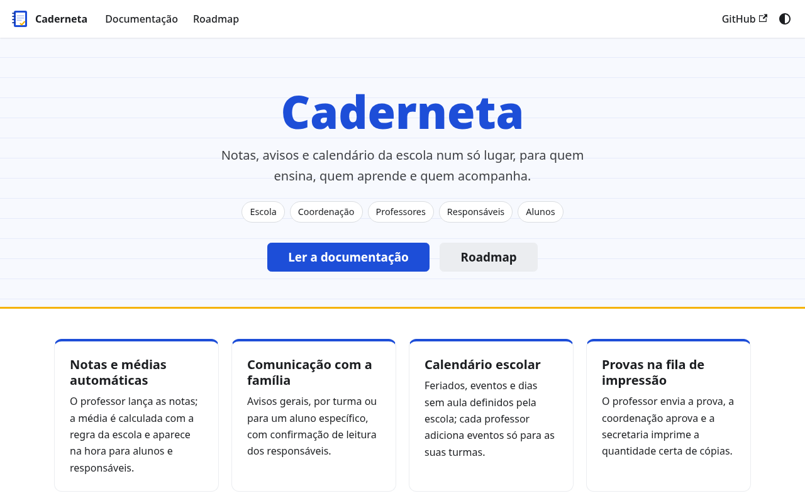
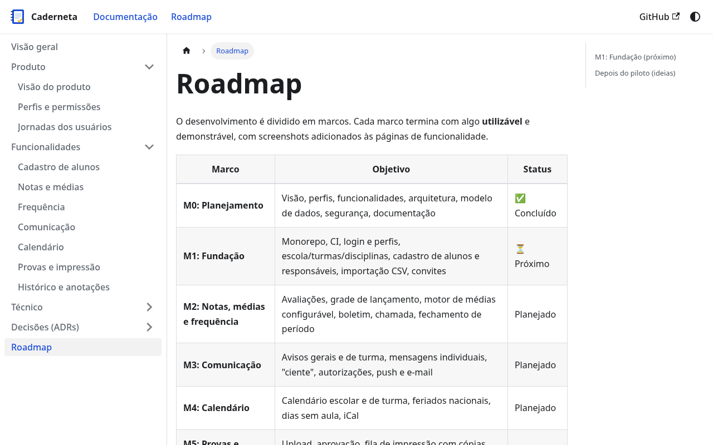
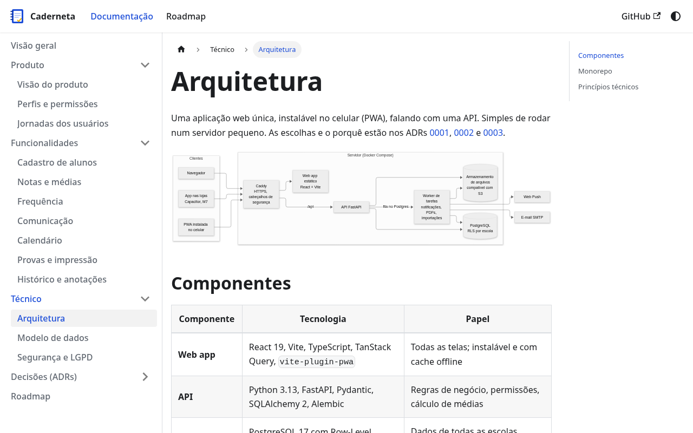
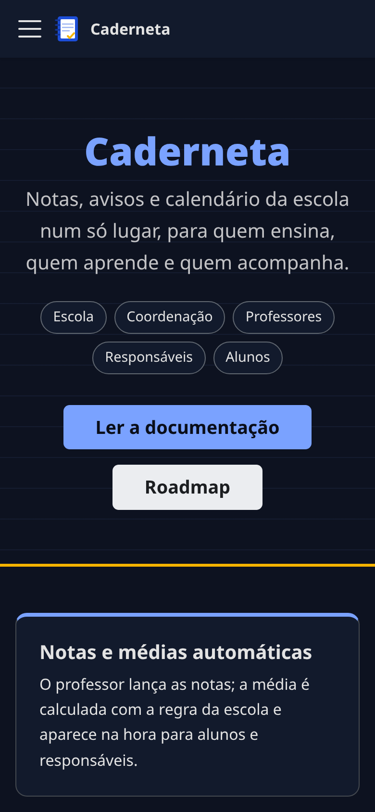

# Caderneta

> *Notas, avisos e calendário da escola num só lugar.*



**Caderneta** é uma plataforma web leve para escolas, professores, responsáveis e alunos. O professor lança as notas e a
média é calculada automaticamente; alunos e famílias acompanham notas, faltas, avisos e o calendário pelo navegador ou
pelo celular. A escola organiza turmas, calendário, comunicação e a fila de impressão de provas, e o histórico do aluno
passa de um ano para o outro.

**Status:** M0 (planejamento) concluído. Próximo: M1, a fundação (login, perfis, turmas e cadastro de alunos).
**[Ler a documentação](https://ettorecsenatore.github.io/caderneta/)** · [Roadmap](https://ettorecsenatore.github.io/caderneta/docs/roadmap)






## Funcionalidades planejadas

- Notas, médias automáticas com regra configurável e boletim ao vivo
- Frequência (chamada) com alertas de limite de faltas
- Avisos gerais, de turma e mensagens individuais com confirmação de leitura
- Calendário escolar e de turma, com feriados e dias sem aula
- Upload de provas e trabalhos com fila de impressão
- Ficha do aluno com dados de saúde protegidos, histórico e anotações entre anos
- PWA instalável e, depois, app nas lojas

## Rodar a documentação localmente

```bash
cd website
npm ci
npm start          # http://localhost:3000/caderneta/
npm run build      # build de produção
```

## Estrutura

```text
caderneta/
├── website/      # documentação (Docusaurus, pt-BR)
├── docs/         # screenshots usados neste README
└── .github/      # CI e deploy da documentação no GitHub Pages
```

O código da aplicação (`api/`, `web/`, `infra/`) começa no M1.

## Segurança

A plataforma lida com dados de menores e de saúde. Veja
[Segurança e LGPD](https://ettorecsenatore.github.io/caderneta/docs/tecnico/seguranca-e-lgpd).
