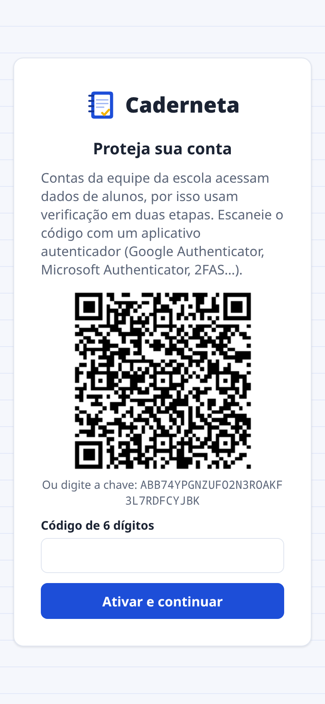

# Caderneta

> *Notas, avisos e calendário da escola num só lugar.*


**Caderneta** é uma plataforma web leve para escolas, professores, responsáveis e alunos. O professor lança as notas e a
média é calculada automaticamente; alunos e famílias acompanham notas, faltas, avisos e o calendário pelo navegador ou
pelo celular. A escola organiza turmas, calendário, comunicação e a fila de impressão de provas, e o histórico do aluno
passa de um ano para o outro.

**Status:** marcos M1 a M7 concluídos (fundação, notas e frequência, comunicação, calendário, provas e impressão, histórico e anotações, modo offline e PWA). M8 (segurança e conformidade): código e documentação prontos, faltam o parecer jurídico e o teste de intrusão. M9 (piloto): em preparação.
Próximos: o app de celular (M7), a revisão de conformidade e segurança (M8) e o piloto (M9). Ainda **não** use com dados reais de alunos
antes do M8.
**[Ler a documentação](https://ettorecsenatore.github.io/caderneta/)** · [Roadmap](https://ettorecsenatore.github.io/caderneta/docs/roadmap)


   

## Funcionalidades planejadas

- Notas, médias automáticas com regra configurável e boletim ao vivo
- Frequência (chamada) com alertas de limite de faltas
- Avisos gerais, de turma e mensagens individuais com confirmação de leitura
- Calendário escolar e de turma, com feriados e dias sem aula
- Upload de provas e trabalhos com fila de impressão
- Ficha do aluno com dados de saúde protegidos, histórico e anotações entre anos
- PWA instalável e, depois, app nas lojas

## Rodar localmente

```bash
cd infra && docker compose up -d                      # Postgres + Mailpit
cd ../api && python -m venv .venv && .venv/bin/pip install -e '.[dev]'
.venv/bin/alembic upgrade head && .venv/bin/python -m app.seed
.venv/bin/uvicorn app.main:app --reload --port 8000
cd ../web && npm ci && npm run dev                    # http://localhost:5173
```

Passo a passo, contas de demonstração e variáveis de ambiente em
[Como rodar localmente](https://ettorecsenatore.github.io/caderneta/docs/tecnico/desenvolvimento).

## Estrutura

```text
caderneta/
├── api/          # FastAPI + SQLAlchemy + Alembic (RLS por escola), testes com Postgres real
├── web/          # React + Vite, PWA instalável
├── infra/        # Docker Compose de desenvolvimento
├── website/      # documentação (Docusaurus, pt-BR)
└── .github/      # CI: API, web e docs; deploy da documentação no GitHub Pages
```

## Segurança

A plataforma lida com dados de menores e de saúde. Veja
[Segurança e LGPD](https://ettorecsenatore.github.io/caderneta/docs/tecnico/seguranca-e-lgpd).

**Achou uma falha de segurança?** Não abra issue: siga o [SECURITY.md](SECURITY.md).

## Contribuir

Veja o [CONTRIBUTING.md](CONTRIBUTING.md) e o [Código de Conduta](CODE_OF_CONDUCT.md). O nome e o logotipo não fazem parte da licença: veja o [NOTICE](NOTICE).

English: [README.en.md](README.en.md). A documentação do site também está em inglês.

## Licença

A Caderneta é software livre sob a **[GNU Affero General Public License v3.0 ou posterior](LICENSE)** (`AGPL-3.0-or-later`).

- Você pode usar, estudar, modificar e distribuir o código.
- Se você **modificar** a Caderneta e oferecê-la como serviço pela internet, precisa disponibilizar o código-fonte da sua versão
  modificada a quem usa o serviço (seção 13 da licença). Isso mantém o software aberto para as escolas que dependem dele.
- Os componentes de terceiros e suas licenças estão em [THIRD_PARTY_NOTICES.md](THIRD_PARTY_NOTICES.md).
- A documentação e os screenshots (dados fictícios) estão sob [CC BY-SA 4.0](LICENSE-DOCS.md).
- **Vai usar com uma escola real?** Gere o [pacote para o advogado](https://ettorecsenatore.github.io/caderneta/docs/tecnico/pacote-juridico) (`python3 scripts/gerar-pacote-juridico.py`) e faça a revisão com o advogado da escola.
- Mais detalhes, em português, na [página de licença](https://ettorecsenatore.github.io/caderneta/docs/licenca).

Copyright (C) 2026 @EttoreCSenatore e colaboradores da Caderneta.
