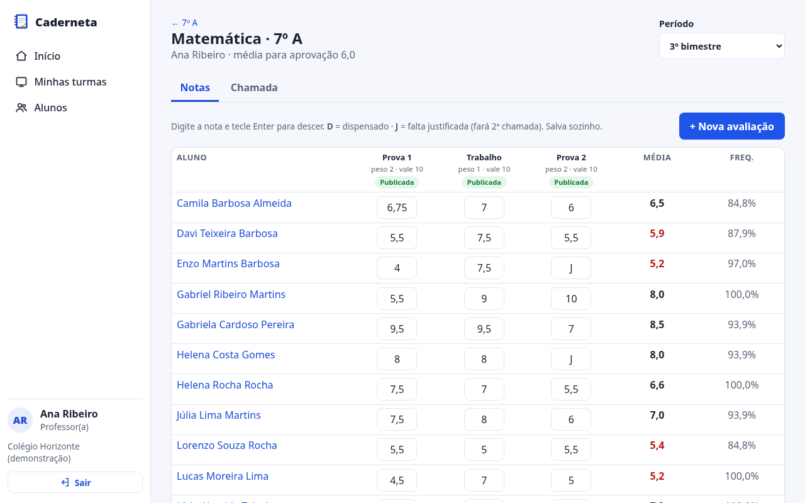
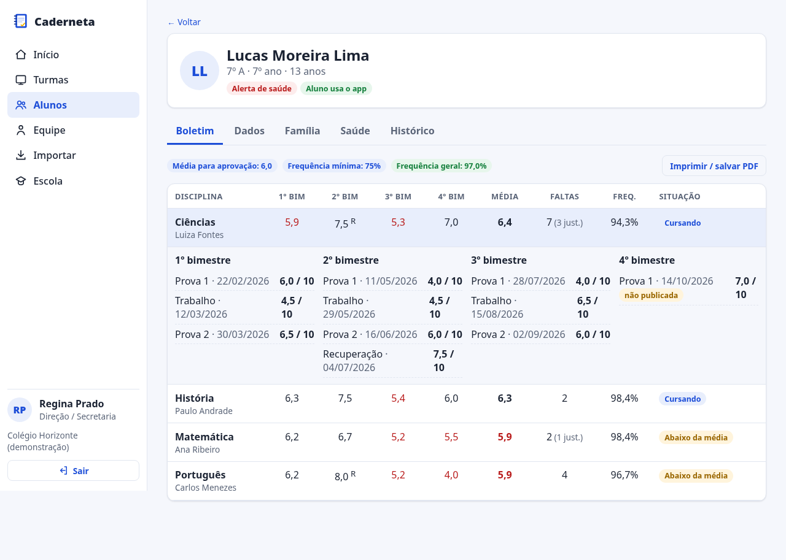
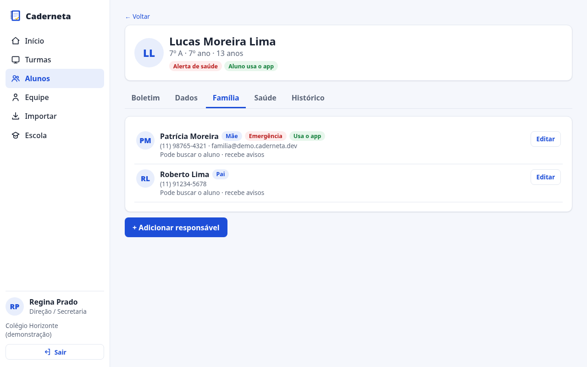
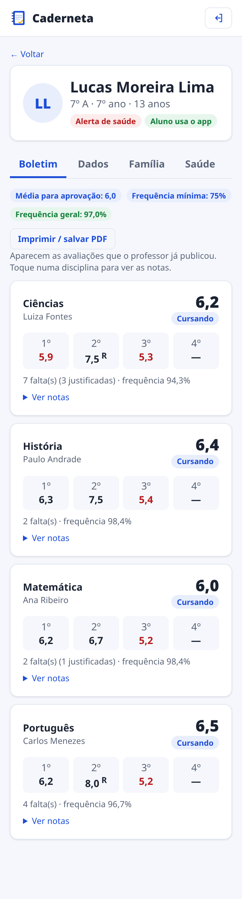
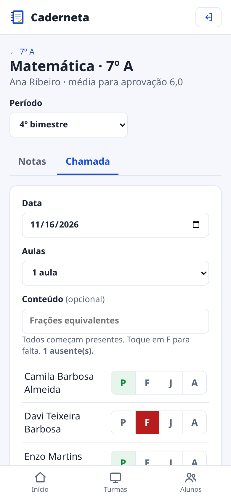
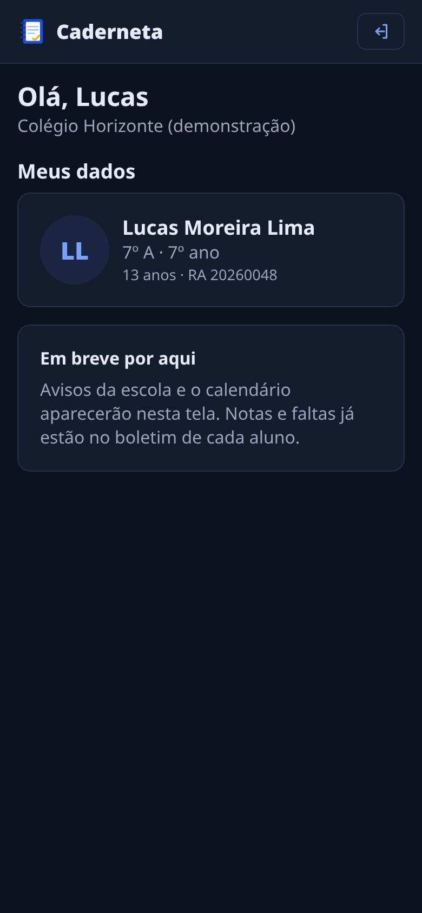

# Caderneta

> *Notas, avisos e calendário da escola num só lugar.*


**Caderneta** é uma plataforma web leve para escolas, professores, responsáveis e alunos. O professor lança as notas e a
média é calculada automaticamente; alunos e famílias acompanham notas, faltas, avisos e o calendário pelo navegador ou
pelo celular. A escola organiza turmas, calendário, comunicação e a fila de impressão de provas, e o histórico do aluno
passa de um ano para o outro.

**Status:** M2 (notas, médias e frequência) concluído: diário de notas com média automática, regra configurável,
boletim para tela e impressão, chamada e fechamento de período. Antes, o M1 trouxe login com 2FA, convites, turmas,
alunos e ficha de saúde. Próximo: M3, comunicação.
**[Ler a documentação](https://ettorecsenatore.github.io/caderneta/)** · [Roadmap](https://ettorecsenatore.github.io/caderneta/docs/roadmap)





   

## Funcionalidades planejadas

- Notas, médias automáticas com regra configurável e boletim ao vivo
- Frequência (chamada) com alertas de limite de faltas
- Avisos gerais, de turma e mensagens individuais com confirmação de leitura
- Calendário escolar e de turma, com feriados e dias sem aula
- Upload de provas e trabalhos com fila de impressão
- Ficha do aluno com dados de saúde protegidos, histórico e anotações entre anos
- PWA instalável e, depois, app nas lojas

## Rodar localmente

```bash
cd infra && docker compose up -d                      # Postgres + Mailpit
cd ../api && python -m venv .venv && .venv/bin/pip install -e '.[dev]'
.venv/bin/alembic upgrade head && .venv/bin/python -m app.seed
.venv/bin/uvicorn app.main:app --reload --port 8000
cd ../web && npm ci && npm run dev                    # http://localhost:5173
```

Passo a passo, contas de demonstração e variáveis de ambiente em
[Como rodar localmente](https://ettorecsenatore.github.io/caderneta/docs/tecnico/desenvolvimento).

## Estrutura

```text
caderneta/
├── api/          # FastAPI + SQLAlchemy + Alembic (RLS por escola), testes com Postgres real
├── web/          # React + Vite, PWA instalável
├── infra/        # Docker Compose de desenvolvimento
├── website/      # documentação (Docusaurus, pt-BR)
└── .github/      # CI: API, web e docs; deploy da documentação no GitHub Pages
```

## Segurança

A plataforma lida com dados de menores e de saúde. Veja
[Segurança e LGPD](https://ettorecsenatore.github.io/caderneta/docs/tecnico/seguranca-e-lgpd).
