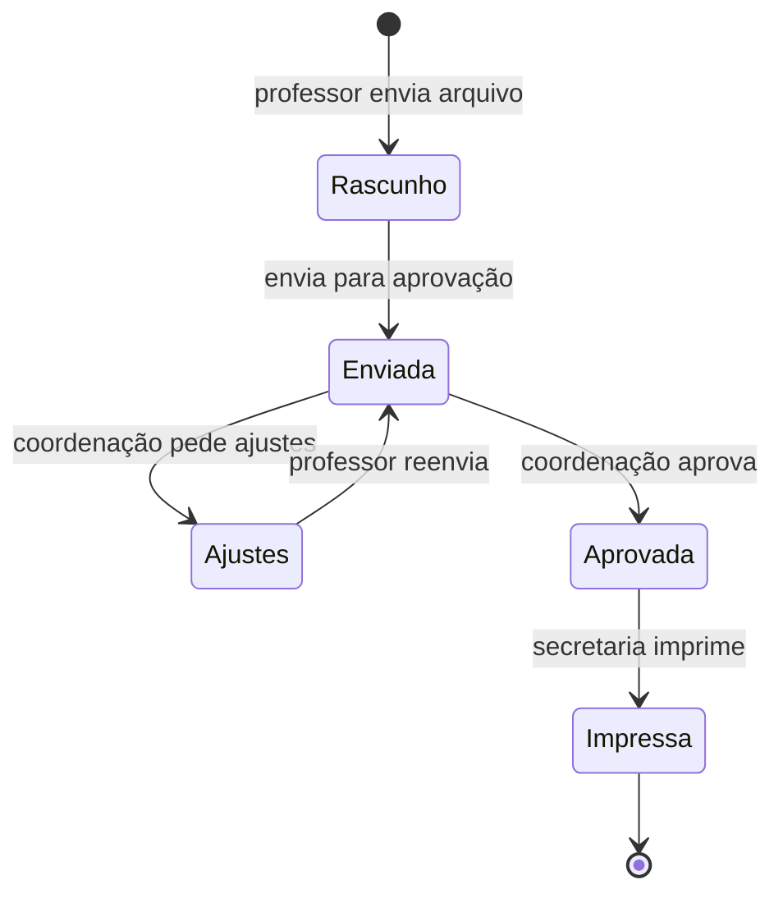

# Provas, trabalhos e fila de impressão

O professor envia o arquivo da prova ou do trabalho; a escola recebe numa fila organizada por data de aplicação.

## Fluxo

A aprovação da coordenação é opcional: a escola pode desligá-la e mandar direto para a fila de impressão.

## Dados de cada pedido

- Arquivo (PDF recomendado; DOCX aceito e convertido para PDF para impressão fiel)
- Turma(s), disciplina, data de aplicação
- **Cópias**: calculadas pelo número de alunos ativos da turma + reserva configurável; editável
- Frente e verso, colorido ou P&B, grampear
- Versão adaptada (ex.: fonte ampliada) para alunos com necessidades específicas
- Prazo: a escola define a antecedência mínima (ex.: 48 h antes da aplicação)

## Segurança

Provas são material sigiloso até a aplicação:

- só o professor autor, a coordenação e a secretaria acessam o arquivo;
- downloads por link temporário assinado, registrados na auditoria;
- alunos e responsáveis nunca veem o arquivo, a menos que o professor publique depois da aplicação (ex.: gabarito).

## Trabalhos

O mesmo fluxo serve para **trabalhos e listas de exercícios**; neles o professor pode também publicar o enunciado
para a turma, que aparece no calendário com a data de entrega.

## O que já funciona (M5)

Tela **Provas** (professores, coordenação e direção/secretaria) e **Materiais** (famílias e alunos).

- **Novo pedido:** o professor envia **PDF ou DOCX** (até 15 MB), escolhe tipo (prova, trabalho ou lista), data, **uma ou mais turmas**
  (o mesmo arquivo gera um pedido por turma) e opções de impressão. Pode anexar uma **versão adaptada** (ex.: fonte ampliada) com a sua
  quantidade de cópias. Começa como **rascunho**.
- **Cópias calculadas:** alunos ativos da turma no ano letivo aberto + reserva da escola (padrão 2). O professor vê a conta e pode editar;
  a secretaria também pode ajustar até a impressão. O pedido guarda o valor calculado ao lado do valor final.
- **Fluxo:** rascunho → em análise → (ajustes ↔ em análise) → na fila → impresso. **Quem aprova:** direção ou coordenação, que também pede
  ajustes com comentário obrigatório. **Quem imprime:** só a direção/secretaria (perfil admin). Cada passo notifica quem precisa agir.
- **Regras da escola** (direção): exigir ou não a aprovação (sem ela, o envio já vai para a fila), cópias de reserva e **antecedência
  mínima** em dias. Pedido fora da antecedência é bloqueado para o professor e marcado como "fora da antecedência"; a direção pode abrir exceção.
- **Fila de impressão:** filtro por situação e por período da aplicação, ordenada pela data, com o total de cópias já aprovadas.
- **Sigilo:** o arquivo só abre para o autor, a coordenação e a direção. Famílias e alunos **não veem o pedido** até o professor
  **publicar**. Uma **prova só pode ser publicada a partir da data de aplicação** (gabarito, por exemplo). Trabalhos e listas podem ser publicados
  depois de aprovados e passam a aparecer no [Calendário](./calendario.md) com a data de entrega. Quem recebe vê só o arquivo principal,
  nunca a versão adaptada.
- **Download:** link assinado de 5 minutos, preso ao usuário. A API confere o acesso de novo na hora e registra **`pedido.baixar`** na
  auditoria. Não existe URL permanente do arquivo.
- **Cifrado em repouso:** veja a [ADR 0004](../decisoes/armazenamento-de-arquivos.md).

### Segurança dos arquivos

- **Antivírus** (ClamAV) em todo envio, com falha fechada, obrigatório em produção.
- **DOCX é convertido para PDF** no servidor (LibreOffice isolado), então a impressão sai fiel e só o PDF é guardado.
- **Retenção:** pedidos são eliminados 365 dias após a aplicação e rascunhos parados após 90 dias.
- Detalhes na [ADR 0004](../decisoes/armazenamento-de-arquivos.md).

Fica para depois: armazenamento S3 compatível (M9).

## Critérios de pronto (M5)

- [x] Upload com verificação de tipo, conteúdo e tamanho
- [x] Fluxo de status com aprovação opcional e comentários
- [x] Fila de impressão filtrável por data, com cópias calculadas
- [x] Download por URL assinada e auditado
