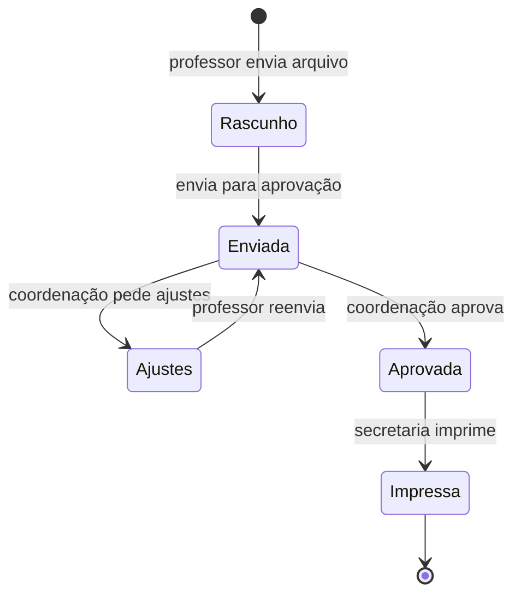

# Provas, trabalhos e fila de impressão

O professor envia o arquivo da prova ou do trabalho; a escola recebe numa fila organizada por data de aplicação.

## Fluxo

A aprovação da coordenação é opcional: a escola pode desligá-la e mandar direto para a fila de impressão.

## Dados de cada pedido

- Arquivo (PDF recomendado; DOCX aceito e convertido para PDF para impressão fiel)
- Turma(s), disciplina, data de aplicação
- **Cópias**: calculadas pelo número de alunos ativos da turma + reserva configurável; editável
- Frente e verso, colorido ou P&B, grampear
- Versão adaptada (ex.: fonte ampliada) para alunos com necessidades específicas
- Prazo: a escola define a antecedência mínima (ex.: 48 h antes da aplicação)

## Segurança

Provas são material sigiloso até a aplicação:

- só o professor autor, a coordenação e a secretaria acessam o arquivo;
- downloads por link temporário assinado, registrados na auditoria;
- alunos e responsáveis nunca veem o arquivo, a menos que o professor publique depois da aplicação (ex.: gabarito).

## Trabalhos

O mesmo fluxo serve para **trabalhos e listas de exercícios**; neles o professor pode também publicar o enunciado
para a turma, que aparece no calendário com a data de entrega.

## Critérios de pronto (M5)

- [ ] Upload com verificação de tipo e tamanho
- [ ] Fluxo de status com aprovação opcional e comentários
- [ ] Fila de impressão filtrável por data, com cópias calculadas
- [ ] Download por URL assinada e auditado
