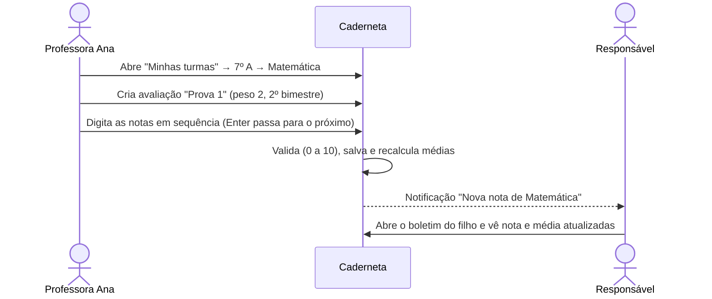

# Jornadas dos usuários

As jornadas abaixo guiam o desenho das telas. Cada uma deve ser possível em poucos toques no celular.

## Professora Ana lança as notas da prova

## Secretaria imprime as provas da semana

1. A coordenação aprova a prova enviada pelo professor.
2. A secretaria abre **Fila de impressão**, filtrada por data de aplicação.
3. Cada item mostra turma, quantidade de cópias (calculada pelo número de alunos + reserva), frente e verso e prazo.
4. Ao imprimir, marca como **Impressa**; o professor vê o status mudar.

## Pai acompanha o filho

1. Recebe convite por e-mail ou WhatsApp com link e cria a senha.
2. Na tela inicial vê, para cada filho: últimas notas, médias do bimestre, faltas, próximos eventos e avisos não lidos.
3. Abre um aviso importante e toca em **Ciente**.
4. Responde a uma mensagem da professora.

## Escola publica o calendário do ano

1. Ao criar o ano letivo, a Caderneta já sugere os **feriados nacionais**.
2. A escola adiciona feriados municipais, recessos, reuniões de pais, festas e dias sem aula.
3. Todas as turmas veem o calendário geral; professores adicionam eventos só para as suas turmas.

## Virada de ano

1. A escola cria o novo ano letivo e as novas turmas.
2. Usa **Rematrícula em lote**: escolhe a turma de origem, marca aprovados/retidos e a turma de destino.
3. O histórico (notas finais, frequência, anotações) fica guardado e visível para os novos professores conforme a permissão.
