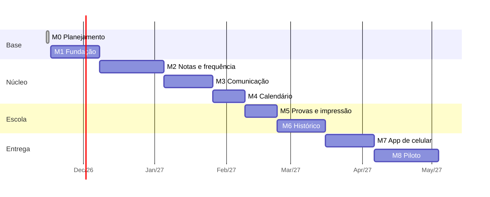

# Roadmap

O desenvolvimento é dividido em marcos. Cada marco termina com algo **utilizável** e demonstrável, com screenshots
adicionados às páginas de funcionalidade.

| Marco | Objetivo | Status |
|---|---|---|
| **M0: Planejamento** | Visão, perfis, funcionalidades, arquitetura, modelo de dados, segurança, documentação | ✅ Concluído |
| **M1: Fundação** | Monorepo, CI, login e perfis, escola/turmas/disciplinas, cadastro de alunos e responsáveis, importação CSV, convites | ✅ Concluído |
| **M2: Notas, médias e frequência** | Avaliações, grade de lançamento, motor de médias configurável, boletim, chamada, fechamento de período | ✅ Concluído |
| **M3: Comunicação** | Avisos gerais e de turma, mensagens individuais, "ciente", autorizações, push e e-mail | ⏳ Próximo |
| **M4: Calendário** | Calendário escolar e de turma, feriados nacionais, dias sem aula, iCal | Planejado |
| **M5: Provas e impressão** | Upload, aprovação, fila de impressão com cópias calculadas, trabalhos | Planejado |
| **M6: Histórico e anotações** | Rematrícula em lote, linha do tempo, anotações versionadas, histórico escolar em PDF | Planejado |
| **M7: App de celular** | PWA refinada, offline para notas e chamada, Capacitor nas lojas | Planejado |
| **M8: Piloto** | Deploy de produção, backups, RIPD/LGPD, revisão de segurança, piloto com uma escola | Planejado |

As datas são estimativas para orientar a ordem; o ritmo real ajusta o gráfico a cada marco.

## M1: Fundação (concluído)

Objetivo: uma escola consegue se cadastrar, montar as turmas e convidar professores e famílias.
Veja [Acesso e convites](./funcionalidades/acesso-e-convites.md), [Escola e turmas](./funcionalidades/escola-e-turmas.md)
e [Cadastro de alunos](./funcionalidades/cadastro-de-alunos.md).

- [x] Monorepo `api/`, `web/`, `infra/`; Docker Compose de desenvolvimento com Postgres e Mailpit (MinIO entra no M5, junto com os arquivos)
- [x] CI: lint, typecheck, testes, `pip-audit`/`npm audit`, build da documentação
- [x] Login, sessão segura, 2FA para administradores, recuperação de senha
- [x] Perfis por escola e troca de perfil no menu
- [x] RLS por escola com testes de isolamento
- [x] Ano letivo, períodos, turmas, disciplinas e atribuições de professores
- [x] Ficha do aluno, vínculos de responsáveis, ficha de saúde criptografada
- [x] Importação CSV com pré-visualização
- [x] Convites por link de uso único
- [x] Dados de demonstração (escola fictícia) para desenvolvimento e screenshots
- [x] Screenshots nas páginas de [Cadastro de alunos](./funcionalidades/cadastro-de-alunos.md) e [Perfis](./produto/perfis.md)

:::note Notas do M1
- 31 testes de API rodam contra um PostgreSQL real com o papel restrito da aplicação, então o isolamento por escola (RLS)
  é testado de verdade, inclusive direto no banco.
- Bug encontrado nos testes manuais: no FastAPI atual, o commit de dependências com `yield` rodava **depois** de a
  resposta sair, e o navegador às vezes chamava `/auth/me` antes de a sessão existir. Corrigido com
  `Depends(get_db, scope="function")` e protegido por um teste de regressão.
- JavaScript inicial do web app: cerca de 100 KB (gzip), metade da meta de 200 KB.
:::

## M2: Notas, médias e frequência (concluído)

Veja [Notas e médias](./funcionalidades/notas-e-medias.md) e [Frequência](./funcionalidades/frequencia.md).

- [x] Avaliações com peso e período; grade de lançamento com teclado e salvamento automático
- [x] Motor de médias configurável por escola, com testes de tabela para cada regra
- [x] Boletim do aluno e do responsável, publicação controlada pelo professor
- [x] Chamada por aula e percentual de frequência
- [x] Fechamento de período com correção justificada e auditada
- [x] Boletim para impressão e PDF pelo navegador

:::note Notas do M2
- 72 testes na API (motor de médias em tabela, permissões do diário, fechamento, boletim da família, chamada,
  regra de média e um teste que exige RLS em toda tabela escolar nova).
- Encontrado nos testes manuais e corrigido: o boletim dava "Reprovado" com o último bimestre ainda aberto; agora a
  situação final só sai com todos os períodos fechados. A busca de alunos passou a aceitar o nome completo. No celular,
  tabelas largas alargavam a página; agora rolam dentro do cartão, e o boletim vira cartões por disciplina.
- Screenshots gerados por `npm run screenshots` em `web/` (Playwright), a partir da escola de demonstração.
- Mudanças de escopo: alertas de faltas e aviso de nota nova vão para o M3 (notificações); bloqueio de chamada em dia
  sem aula vai para o M4 (calendário); lançamento offline vai para o M7; PDF gerado no servidor fica para o histórico
  escolar do M6.
:::

## M3: Comunicação (próximo)

- [ ] Avisos gerais (escola, segmento, grupo de turmas) e de turma, com agendamento
- [ ] Mensagens individuais escola/professor ↔ família, com anexos
- [ ] "Ciente" e painel de leitura para quem enviou; lembrete aos pendentes
- [ ] Autorizações digitais (passeio, saída antecipada)
- [ ] Notificações no app, push (PWA) e e-mail, com horário silencioso
- [ ] Alertas de faltas (15% e 20%) e de nota nova publicada

## Depois do piloto (ideias)

- Grade horária e substituições de professores
- Tarefas de casa com entrega online
- Relatórios para a direção (desempenho por turma, alunos em risco)
- Integração com WhatsApp Business para notificações
- Portal de matrícula para novos alunos
- Versão em inglês e espanhol da interface
