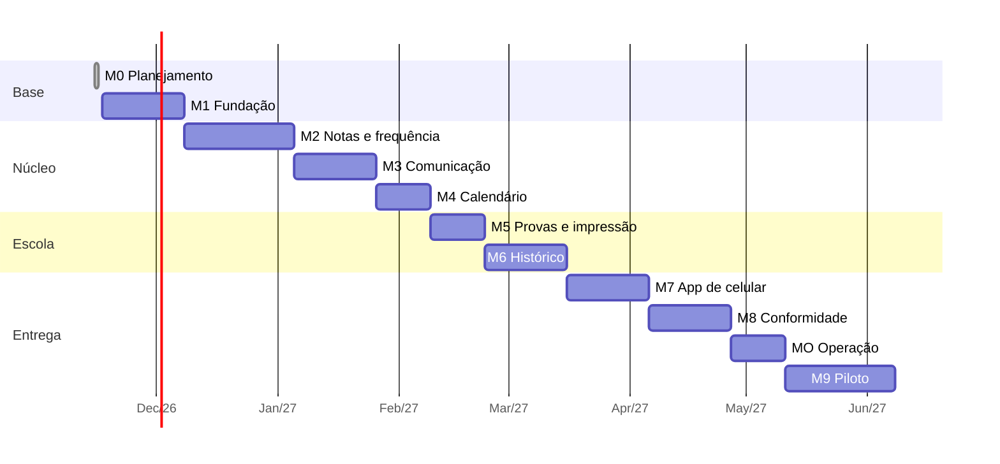

# Roadmap

O desenvolvimento é dividido em marcos. Cada marco termina com algo **utilizável** e demonstrável, com screenshots
adicionados às páginas de funcionalidade.

| Marco | Objetivo | Status |
|---|---|---|
| **M0: Planejamento** | Visão, perfis, funcionalidades, arquitetura, modelo de dados, segurança, documentação | ✅ Concluído |
| **M1: Fundação** | Monorepo, CI, login e perfis, escola/turmas/disciplinas, cadastro de alunos e responsáveis, importação CSV, convites | ✅ Concluído |
| **M2: Notas, médias e frequência** | Avaliações, grade de lançamento, motor de médias configurável, boletim, chamada, fechamento de período | ✅ Concluído |
| **M3: Comunicação** | Avisos gerais e de turma, mensagens individuais, "ciente", autorizações, notificações, e-mail e push | ✅ Concluído |
| **M4: Calendário** | Calendário escolar e de turma, feriados nacionais, dias sem aula, iCal | ✅ Concluído |
| **M5: Provas e impressão** | Upload, aprovação, fila de impressão com cópias calculadas, trabalhos | ✅ Concluído |
| **M6: Histórico e anotações** | Rematrícula em lote, linha do tempo, anotações versionadas, histórico escolar em PDF | ✅ Concluído |
| **M7: App de celular** | PWA refinada, offline para notas e chamada (lojas ficam para depois do piloto) | ✅ Concluído |
| **M8: Conformidade e segurança** | Revisão geral de segurança, licenças e adequação à LGPD e à legislação aplicável, com validação jurídica | Código e documentação prontos; falta o parecer jurídico e o teste de intrusão |
| **MO: Operação e manutenção** | Cadeia de suprimentos, arquivos do repositório, versões e Novidades no app, avisos de operação, testes de migrations e de cobertura, ferramentas de dados de teste (feito antes do piloto) | Em andamento |
| **M9: Piloto** | Deploy de produção, backups, piloto com uma escola (só começa com o M8 aprovado) | Em preparação |

As datas são estimativas para orientar a ordem; o ritmo real ajusta o gráfico a cada marco.

Esta documentação está disponível em **português e em inglês** (seletor de idioma no topo). Os textos legais e os artefatos de conformidade ficam em português, porque aplicam a lei brasileira.

## M1: Fundação (concluído)

Objetivo: uma escola consegue se cadastrar, montar as turmas e convidar professores e famílias.
Veja [Acesso e convites](./funcionalidades/acesso-e-convites.md), [Escola e turmas](./funcionalidades/escola-e-turmas.md)
e [Cadastro de alunos](./funcionalidades/cadastro-de-alunos.md).

- [x] Monorepo `api/`, `web/`, `infra/`; Docker Compose de desenvolvimento com Postgres e Mailpit (MinIO entra no M5, junto com os arquivos)
- [x] CI: lint, typecheck, testes, `pip-audit`/`npm audit`, build da documentação
- [x] Login, sessão segura, 2FA para administradores, recuperação de senha
- [x] Perfis por escola e troca de perfil no menu
- [x] RLS por escola com testes de isolamento
- [x] Ano letivo, períodos, turmas, disciplinas e atribuições de professores
- [x] Ficha do aluno, vínculos de responsáveis, ficha de saúde criptografada
- [x] Importação CSV com pré-visualização
- [x] Convites por link de uso único
- [x] Dados de demonstração (escola fictícia) para desenvolvimento e screenshots
- [x] Screenshots nas páginas de [Cadastro de alunos](./funcionalidades/cadastro-de-alunos.md) e [Perfis](./produto/perfis.md)

:::note Notas do M1
- 31 testes de API rodam contra um PostgreSQL real com o papel restrito da aplicação, então o isolamento por escola (RLS)
  é testado de verdade, inclusive direto no banco.
- Bug encontrado nos testes manuais: no FastAPI atual, o commit de dependências com `yield` rodava **depois** de a
  resposta sair, e o navegador às vezes chamava `/auth/me` antes de a sessão existir. Corrigido com
  `Depends(get_db, scope="function")` e protegido por um teste de regressão.
- JavaScript inicial do web app: cerca de 100 KB (gzip), metade da meta de 200 KB.
:::

## M2: Notas, médias e frequência (concluído)

Veja [Notas e médias](./funcionalidades/notas-e-medias.md) e [Frequência](./funcionalidades/frequencia.md).

- [x] Avaliações com peso e período; grade de lançamento com teclado e salvamento automático
- [x] Motor de médias configurável por escola, com testes de tabela para cada regra
- [x] Boletim do aluno e do responsável, publicação controlada pelo professor
- [x] Chamada por aula e percentual de frequência
- [x] Fechamento de período com correção justificada e auditada
- [x] Boletim para impressão e PDF pelo navegador

:::note Notas do M2
- 72 testes na API (motor de médias em tabela, permissões do diário, fechamento, boletim da família, chamada,
  regra de média e um teste que exige RLS em toda tabela escolar nova).
- Encontrado nos testes manuais e corrigido: o boletim dava "Reprovado" com o último bimestre ainda aberto; agora a
  situação final só sai com todos os períodos fechados. A busca de alunos passou a aceitar o nome completo. No celular,
  tabelas largas alargavam a página; agora rolam dentro do cartão, e o boletim vira cartões por disciplina.
- Screenshots gerados por `npm run screenshots` em `web/` (Playwright), a partir da escola de demonstração.
- Mudanças de escopo: alertas de faltas e aviso de nota nova vão para o M3 (notificações); bloqueio de chamada em dia
  sem aula vai para o M4 (calendário); lançamento offline vai para o M7; PDF gerado no servidor fica para o histórico
  escolar do M6.
:::

## M3: Comunicação (concluído)

- [x] Avisos da escola e de turma, com agendamento (segmento e grupo de turmas ficam para depois)
- [x] Mensagens individuais escola/professor ↔ família (anexos de PDF e imagem, 3 por mensagem, com antivírus e sem EXIF)
- [x] "Ciente" e painel de leitura para quem enviou
- [x] Lembrete aos pendentes
- [x] Autorizações digitais (passeio, saída antecipada)
- [x] Notificações no app e e-mail com horário silencioso, e-mail sem conteúdo e só para adultos
- [x] Push (PWA) sem conteúdo, só para adultos, com retenção do aparelho (M3.5)
- [x] Alertas de faltas (15% e 20%) e de nota nova publicada

## M8: Conformidade e segurança

Objetivo: antes de qualquer escola real usar a Caderneta, revisar tudo o que envolve **segurança, licenças e lei**.
A Caderneta trata dados de crianças e adolescentes e dados de saúde, então estar em conformidade é requisito de
lançamento, não detalhe. O piloto (M9) **só começa com este marco aprovado**.

Referência principal: a [campanha de LGPD do Ministério do Desenvolvimento e Assistência Social](https://www.gov.br/mds/pt-br/acesso-a-informacao/governanca/integridade/campanhas/lgpd),
junto com o texto da Lei nº 13.709/2018 e as orientações da ANPD.

### Ordem de trabalho do M8

O M8 é grande, então corre em etapas, cada uma com seu PR:

1. **M8.1 Segurança do código ✅:** auditoria de dependências (`pip-audit`, `npm audit`, SBOM), revisão de autenticação, autorização e RLS, limites de taxa (T21), cabeçalhos, checklist OWASP Top 10/ASVS e corrigir o que aparecer
2. **M8.2 Direitos dos titulares (art. 18) ✅:** fluxo de pedido de acesso, correção, eliminação e portabilidade, com prazo e registro (T1, T19, T20, T25)
3. **M8.3 Transparência ✅ (rascunho):** política de privacidade e termos em linguagem simples, aceite registrado e versionado, canal do encarregado
4. **M8.4 Documentos de conformidade ✅ (rascunhos):** ROPA e RIPD (rascunhos com a skill `lgpd-audit`, **revisão humana e jurídica obrigatória**), plano de resposta a incidentes
5. **M8.5 Operação segura ✅:** backups cifrados e teste de restauração, gestão de chaves, logs sem dado pessoal (T14, T24; parte já prevista para o M9)
6. **Fechamento:** parecer jurídico anexado, pen test por terceiro, critério de aprovação abaixo

### Como a conformidade é conduzida

- **Método:** a skill `lgpd-audit` do repositório [goul4rt/lgpd-skills](https://github.com/goul4rt/lgpd-skills) (pipeline C, híbrido),
  com pausa obrigatória para revisão humana e jurídica no ROPA, no RIPD, na política de privacidade e em comunicações à ANPD.
- **Texto das normas:** conferido no repositório [ctresb/leis](https://github.com/ctresb/leis) (LGPD, ECA Digital, Decreto 12.880/2026, Marco Civil).
  As resoluções da ANPD ainda não estão nele e devem ser conferidas no texto oficial.
- **Artefatos versionados** em [`.lgpd/`](https://github.com/EttoreCSenatore/caderneta/tree/main/.lgpd): `STATUS.md`, `data-map.md` e `gaps.md`.
  O mapa de dados preliminar (M1 a M3.3) já existe; as lacunas priorizadas estão em `gaps.md`.
- **Regra:** todo PR que coletar dado pessoal novo atualiza o mapa de dados e as lacunas.

### Adequação à LGPD e à legislação

- [x] **Mapeamento de dados e ROPA**: mapa (A001 a A019) e ROPA em rascunho, com revisão do encarregado e do jurídico pendente. Veja [Documentos de conformidade](./tecnico/documentos-de-conformidade.md)
- [ ] **Base legal por finalidade** (art. 7º e 11): execução do serviço educacional, obrigação legal e escolar, consentimento só onde for realmente necessário
- [ ] **Dados de crianças e adolescentes** (art. 14): melhor interesse, consentimento específico de um responsável quando for a base, aviso em linguagem clara; revisar também o ECA Digital (Lei nº 15.211/2025)
- [ ] **Dados de saúde** (sensíveis): finalidade restrita, acesso mínimo, criptografia e trilha de acesso, já implementados e a revisar
- [x] **RIPD** em rascunho (17 riscos com matriz e avaliação preliminar do ECA Digital). Pareceres e aprovação pendentes
- [x] **Direitos dos titulares** (art. 18): baixar os próprios dados na hora, pedidos de correção, eliminação, portabilidade e informação com protocolo e prazo de 15 dias, fila para a direção, registro de pedidos recebidos fora do app. Veja [Direitos do titular](./funcionalidades/direitos-do-titular.md). Falta o parecer sobre anotações internas (T19)
- [x] **Sessão de desligados** (decisão do responsável): área separada para alunos e usuários desligados, com contagem regressiva, **aviso antes** de apagar e opção de adiar. Veja [Desligados](./funcionalidades/desligados.md). Falta confirmar com o jurídico o prazo mínimo de guarda do histórico escolar
- [ ] **Retenção e eliminação**: prazos por tipo de dado, respeitando a guarda obrigatória do histórico escolar; rotina de descarte
- [x] **Encarregado (DPO)**: a escola informa nome e e-mail, exibidos na política e em Meus dados. Falta cada escola nomear a pessoa
- [ ] **Operadores e suboperadores**: contratos de operação de dados com a escola e com provedores (hospedagem, e-mail, push); transferência internacional de dados, se houver, com mecanismo legal
- [x] **Plano de resposta a incidentes**: passo a passo, prazos, modelos de comunicação, registro de 5 anos e ferramenta de contenção (`revogar-sessoes`). Falta a **simulação** e os nomes de plantão (T33)
- [x] **Política de privacidade e termos de uso** em linguagem simples, com ciência registrada por versão: veja [Privacidade e termos](./funcionalidades/privacidade-e-termos.md). **Rascunho**: publicar só depois do parecer jurídico
- [x] **Aviso de cookies**: não é necessário (só o cookie de sessão, essencial); a política explica isso e o armazenamento do modo offline
- [ ] **Acessibilidade e consumo**: revisar o que a lei exige conforme o modelo de oferta da plataforma (contrato com escolas)
- [x] **Pacote para o advogado**: gerador de documento único por instalação (`scripts/gerar-pacote-juridico.py`), com 14 perguntas, ficha da instalação, modelo de parecer e todos os anexos. Veja [Pacote para o advogado](./tecnico/pacote-juridico.md). Textos legais próprios por instalação (`CADERNETA_LEGAL_DIR`)
- [ ] **Revisão jurídica**: advogado(a) especializado(a) em proteção de dados valida os documentos acima, **em cada instalação**. A documentação técnica orienta, mas **não substitui parecer jurídico**

### Segurança

- [x] **M8.1** revisão de segurança do código (autenticação, autorização, RLS, uploads, injeção, CSRF, cabeçalhos): veja a [revisão](./tecnico/revisao-de-seguranca.md)
- [ ] **Teste de intrusão** por terceiro
- [x] Dependências: `pip-audit` e `npm audit` no CI e SBOM CycloneDX gerado a cada alteração. Falta a política de atualização (cadência de revisão)
- [x] Chaves: **rotação** da chave de dados (`rotacionar-chave`, lê com a antiga e grava com a nova), uma chave por ambiente, cifra em repouso (AES-GCM) e em trânsito (TLS na implantação). Veja [Backups, chaves e logs](./tecnico/backups-chaves-e-logs.md)
- [x] **Backups cifrados** (AES-256), **teste de restauração** que confere as chaves, expiração em 35 dias e procedimento de restauração que reaplica a retenção. Falta rodar na hospedagem real (M9)
- [x] Logs sem dado pessoal: sem query string e sem segredos de URL no log de acesso. [ ] Monitoramento e alertas ficam para a implantação (M9)
- [ ] Revisão de permissões por perfil (princípio do menor privilégio) e dos acessos de suporte
- [x] Limite de taxa (login, recuperação de senha, convites, conferência do histórico), código 2FA de uso único, trocar senha e sair em todos os aparelhos
- [ ] Decidir 2FA para professores, lista de senhas fracas e códigos de reserva do 2FA
- [x] OWASP Top 10 verificado e registrado na [revisão](./tecnico/revisao-de-seguranca.md)
- [ ] OWASP ASVS nível 2 completo (o pen test cobre o restante)

### Licenças

- [x] **Licença do código: AGPL-3.0-or-later** (decisão do responsável), com `LICENSE`, metadados nos manifestos e a [página de licença](./licenca.md)
- [x] **Licença da documentação e dos screenshots: CC BY-SA 4.0**, com dados fictícios nas demonstrações ([`LICENSE-DOCS.md`](https://github.com/EttoreCSenatore/caderneta/blob/main/LICENSE-DOCS.md))
- [x] **Auditoria de licenças de dependências** (npm e Python): `scripts/auditar-licencas.py` no CI e `THIRD_PARTY_NOTICES.md` gerado
- [ ] Licenças de fontes, ícones, imagens e logotipo
- [ ] Marca "Caderneta": registro no INPI é opcional (não será feito agora); só uma consulta rápida e gratuita à base do INPI antes do piloto, trocando o nome se houver conflito

### Critério de aprovação

- Todos os itens acima concluídos ou com decisão e justificativa registradas
- Parecer jurídico anexado e correções aplicadas
- Pen test sem pendência crítica ou alta
- Documentos públicos (privacidade, termos) publicados

:::note Conformidade contínua, não só no M8
Cada marco anterior deve **atualizar o inventário de dados e o RIPD** quando coletar dado novo, e cada PR é revisado quanto
a acesso mínimo, auditoria e retenção. O M8 é a revisão geral, não o primeiro momento em que a lei é considerada.
:::

## M4: Calendário (concluído)

Veja [Calendário](./funcionalidades/calendario.md).

- [x] Eventos da escola e das turmas, com permissões por papel
- [x] Feriados nacionais por lei, confirmados pela escola; datas móveis calculadas
- [x] Dias sem aula e feriados bloqueiam a chamada e avisam as famílias
- [x] Avaliações com data aparecem no calendário da turma
- [x] Visões lista, mês e semana
- [x] Assinatura iCal por link secreto, revogável

## M5: Provas e impressão (concluído)

Veja [Provas e impressão](./funcionalidades/provas-e-impressao.md) e a [ADR 0004](./decisoes/armazenamento-de-arquivos.md).

- [x] Upload validado pelo conteúdo, cifrado em repouso
- [x] Fluxo com aprovação opcional, ajustes e comentários; antecedência mínima configurável
- [x] Fila de impressão com cópias calculadas (alunos ativos + reserva) e versão adaptada
- [x] Sigilo até a publicação; prova só publicada a partir da aplicação; trabalhos no calendário
- [x] Download por link assinado de 5 minutos, auditado
- [x] Antivírus (ClamAV, falha fechada), conversão de DOCX para PDF, anexos nas mensagens sem EXIF e retenção dos arquivos

## M6: Histórico e anotações (concluído)

Veja [Histórico e anotações](./funcionalidades/historico-e-anotacoes.md).

- [x] M6.1: turmas do novo ano, rematrícula em lote com sugestão do boletim, encerramento do ano, linha do tempo
- [x] Acesso a alunos e turmas só pelo ano letivo aberto (privacidade na virada)
- [x] M6.2: anotações versionadas (pedagógica, ocorrência, elogio, reservada) com visibilidade por tipo, auditoria da reservada e eliminação 30 dias após remover
- [x] M6.3: histórico escolar em PDF (gerador próprio, [ADR 0005](./decisoes/pdf-proprio.md)), emissão registrada e conferência pública do código

## M7: App de celular (concluído)

Veja [Modo offline](./funcionalidades/offline.md).

- [x] M7.1: notas e chamada offline para professores, com cofre cifrado no aparelho, fila de envio, apagamento ao sair e após 7 dias sem conexão
- [x] Correção: sair da conta travava quando o navegador não tinha service worker
- [x] M7.2 PWA: o app abre sem internet (identidade, turmas e diários vêm do cofre cifrado), convite de instalação (Android/desktop e dica para iPhone), atalhos, tema escuro na barra, teste de ponta a ponta com Chromium e internet cortada (`npm run e2e:offline`)
- [ ] Testar em aparelhos reais (Android e iPhone) com a PWA instalada, incluindo o push: **passa para o M9** (checklist do piloto)
- [x] Capacitor/lojas: **decisão do responsável (2026-11-17): fora do piloto.** A PWA instalada basta; lojas custam conta paga, revisão e reabrem a análise de privacidade. Reavaliar depois do piloto se a escola pedir

## MO: Operação e manutenção (antes do piloto)

Ideias adaptadas de outro sistema open source de gestão, o [Kaladrius](https://github.com/facchini-miguel/kaladrius) (clínicas, Apache 2.0). O foco é manter a Caderneta segura e fácil de atualizar depois que ela estiver em uso. Cada passo é um PR, na ordem abaixo.

- [x] **MO.1 Cadeia de suprimentos** ([#37](https://github.com/EttoreCSenatore/caderneta/issues/37)): Dependabot para Python, os dois projetos npm, GitHub Actions e imagens Docker, com espera de 7 dias para versões novas (correções de segurança vêm na hora) e PRs agrupados; Actions fixadas pelo commit; imagens fixadas pelo digest, com teste que exige o mesmo Postgres no desenvolvimento e na produção
- [x] **MO.2 Arquivos do repositório** ([#38](https://github.com/EttoreCSenatore/caderneta/issues/38)): `SECURITY.md` (como reportar uma falha), `CONTRIBUTING.md`, `CODE_OF_CONDUCT.md`, `CODEOWNERS` e `NOTICE` (o nome e o logo não fazem parte da licença)
- [x] **MO.3 Versões e Novidades** ([#39](https://github.com/EttoreCSenatore/caderneta/issues/39)): um `releases.yaml` como fonte única; versão no rodapé e em `/api/saude`; página Novidades no app e aviso "versão nova, veja o que mudou"; tag e release no GitHub geradas do mesmo arquivo; página de versionamento na documentação
- [x] **MO.4 Avisos de operação** ([#40](https://github.com/EttoreCSenatore/caderneta/issues/40)): cada backup fica registrado no banco; a direção e o responsável de TI veem uma faixa quando o último backup tem mais de 26 horas ou quando disco ou memória do servidor chegam ao limite (cobre parte da lacuna T35)
- [ ] **MO.5 Migrations** ([#41](https://github.com/EttoreCSenatore/caderneta/issues/41)): teste de aplicar, desfazer e aplicar de novo na CI; relatório no PR com o SQL de cada migration nova e as operações que apagam dados
- [ ] **MO.6 Dados de teste** ([#42](https://github.com/EttoreCSenatore/caderneta/issues/42)): comando que apaga só os dados de demonstração (nunca uma escola real) e comando que simula a atividade da semana atual (aulas, chamadas, notas), para a demonstração não parecer parada
- [ ] **MO.7 Cobertura de testes** ([#43](https://github.com/EttoreCSenatore/caderneta/issues/43)): medir a cobertura da API e do web e reprovar a CI abaixo de uma meta fixada a partir do número atual
- [ ] **MO.8 Demonstração pública** ([#44](https://github.com/EttoreCSenatore/caderneta/issues/44)): página com as contas de cada papel e os dados fictícios recriados todo dia; **depende da hospedagem** (feito junto com o M9)

## M9: Piloto (em preparação)

Veja [Implantação](./tecnico/implantacao.md) e o [Plano do piloto](./piloto.md). Só começa com **dados reais** depois do M8 aprovado.

- [x] Receita de implantação em uma máquina: `deploy/` com imagens (API e site), Docker Compose de produção, Caddy com HTTPS automático e cabeçalhos de segurança, `.env` de exemplo, gerador de segredos
- [x] Teste de fumaça (`deploy/smoke.sh`), verificação periódica (`verificar.sh`: site, backup atrasado, disco, banco, serviço parado, com aviso ao plantão) e agenda de exemplo (backup e restauração)
- [x] Plano do piloto: porta de entrada (go/no-go), fases, importação, suporte por gravidade, métricas sem dado pessoal, plano de recuo e encerramento
- [x] Pilha completa **testada localmente** com HTTPS de teste
- [ ] **Escolher a hospedagem** e o provedor de e-mail (O8) e preencher a ficha da instalação
- [ ] Rodar a implantação, os backups e o teste de restauração **na hospedagem real**
- [ ] Teste em **aparelhos reais** (Android e iPhone): instalar, abrir sem internet, lançar offline, push (precisa de HTTPS e chaves VAPID)
- [ ] Parecer do advogado, teste de intrusão, plantão e simulação (porta de entrada do M8)
- [ ] Escolher a escola do piloto e executar as fases do plano

## Retenção de desligados (feito antes do M8)

- [x] Apagamento dos dados complementares do aluno e anonimização de contas, com prazos por escola, aviso antes e adiamento
- [ ] Parecer jurídico sobre os prazos padrão (365 e 180 dias) e sobre o prazo mínimo de guarda do histórico

## Depois do piloto (ideias)

- Grade horária e substituições de professores
- Tarefas de casa com entrega online
- Relatórios para a direção (desempenho por turma, alunos em risco)
- Integração com WhatsApp Business para notificações
- Portal de matrícula para novos alunos
- Versão em inglês e espanhol da interface
- Pacote Linux (`apt install caderneta`, com perguntas na tela e backup diário), para escolas sem equipe de TI
- Anonimizar a cópia de uma escola real para testes: só com aval do advogado, por serem dados de menores
