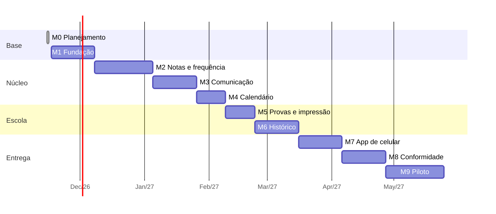

# Roadmap

O desenvolvimento é dividido em marcos. Cada marco termina com algo **utilizável** e demonstrável, com screenshots
adicionados às páginas de funcionalidade.

| Marco | Objetivo | Status |
|---|---|---|
| **M0: Planejamento** | Visão, perfis, funcionalidades, arquitetura, modelo de dados, segurança, documentação | ✅ Concluído |
| **M1: Fundação** | Monorepo, CI, login e perfis, escola/turmas/disciplinas, cadastro de alunos e responsáveis, importação CSV, convites | ✅ Concluído |
| **M2: Notas, médias e frequência** | Avaliações, grade de lançamento, motor de médias configurável, boletim, chamada, fechamento de período | ✅ Concluído |
| **M3: Comunicação** | Avisos gerais e de turma, mensagens individuais, "ciente", autorizações, notificações, e-mail e push | ✅ Concluído |
| **M4: Calendário** | Calendário escolar e de turma, feriados nacionais, dias sem aula, iCal | ✅ Concluído |
| **M5: Provas e impressão** | Upload, aprovação, fila de impressão com cópias calculadas, trabalhos | ✅ Concluído |
| **M6: Histórico e anotações** | Rematrícula em lote, linha do tempo, anotações versionadas, histórico escolar em PDF | ✅ Concluído |
| **M7: App de celular** | PWA refinada, offline para notas e chamada, Capacitor nas lojas | Planejado |
| **M8: Conformidade e segurança** | Revisão geral de segurança, licenças e adequação à LGPD e à legislação aplicável, com validação jurídica | Planejado |
| **M9: Piloto** | Deploy de produção, backups, piloto com uma escola (só começa com o M8 aprovado) | Planejado |

As datas são estimativas para orientar a ordem; o ritmo real ajusta o gráfico a cada marco.

## M1: Fundação (concluído)

Objetivo: uma escola consegue se cadastrar, montar as turmas e convidar professores e famílias.
Veja [Acesso e convites](./funcionalidades/acesso-e-convites.md), [Escola e turmas](./funcionalidades/escola-e-turmas.md)
e [Cadastro de alunos](./funcionalidades/cadastro-de-alunos.md).

- [x] Monorepo `api/`, `web/`, `infra/`; Docker Compose de desenvolvimento com Postgres e Mailpit (MinIO entra no M5, junto com os arquivos)
- [x] CI: lint, typecheck, testes, `pip-audit`/`npm audit`, build da documentação
- [x] Login, sessão segura, 2FA para administradores, recuperação de senha
- [x] Perfis por escola e troca de perfil no menu
- [x] RLS por escola com testes de isolamento
- [x] Ano letivo, períodos, turmas, disciplinas e atribuições de professores
- [x] Ficha do aluno, vínculos de responsáveis, ficha de saúde criptografada
- [x] Importação CSV com pré-visualização
- [x] Convites por link de uso único
- [x] Dados de demonstração (escola fictícia) para desenvolvimento e screenshots
- [x] Screenshots nas páginas de [Cadastro de alunos](./funcionalidades/cadastro-de-alunos.md) e [Perfis](./produto/perfis.md)

:::note Notas do M1
- 31 testes de API rodam contra um PostgreSQL real com o papel restrito da aplicação, então o isolamento por escola (RLS)
  é testado de verdade, inclusive direto no banco.
- Bug encontrado nos testes manuais: no FastAPI atual, o commit de dependências com `yield` rodava **depois** de a
  resposta sair, e o navegador às vezes chamava `/auth/me` antes de a sessão existir. Corrigido com
  `Depends(get_db, scope="function")` e protegido por um teste de regressão.
- JavaScript inicial do web app: cerca de 100 KB (gzip), metade da meta de 200 KB.
:::

## M2: Notas, médias e frequência (concluído)

Veja [Notas e médias](./funcionalidades/notas-e-medias.md) e [Frequência](./funcionalidades/frequencia.md).

- [x] Avaliações com peso e período; grade de lançamento com teclado e salvamento automático
- [x] Motor de médias configurável por escola, com testes de tabela para cada regra
- [x] Boletim do aluno e do responsável, publicação controlada pelo professor
- [x] Chamada por aula e percentual de frequência
- [x] Fechamento de período com correção justificada e auditada
- [x] Boletim para impressão e PDF pelo navegador

:::note Notas do M2
- 72 testes na API (motor de médias em tabela, permissões do diário, fechamento, boletim da família, chamada,
  regra de média e um teste que exige RLS em toda tabela escolar nova).
- Encontrado nos testes manuais e corrigido: o boletim dava "Reprovado" com o último bimestre ainda aberto; agora a
  situação final só sai com todos os períodos fechados. A busca de alunos passou a aceitar o nome completo. No celular,
  tabelas largas alargavam a página; agora rolam dentro do cartão, e o boletim vira cartões por disciplina.
- Screenshots gerados por `npm run screenshots` em `web/` (Playwright), a partir da escola de demonstração.
- Mudanças de escopo: alertas de faltas e aviso de nota nova vão para o M3 (notificações); bloqueio de chamada em dia
  sem aula vai para o M4 (calendário); lançamento offline vai para o M7; PDF gerado no servidor fica para o histórico
  escolar do M6.
:::

## M3: Comunicação (concluído)

- [x] Avisos da escola e de turma, com agendamento (segmento e grupo de turmas ficam para depois)
- [x] Mensagens individuais escola/professor ↔ família (anexos de PDF e imagem, 3 por mensagem, com antivírus e sem EXIF)
- [x] "Ciente" e painel de leitura para quem enviou
- [x] Lembrete aos pendentes
- [x] Autorizações digitais (passeio, saída antecipada)
- [x] Notificações no app e e-mail com horário silencioso, e-mail sem conteúdo e só para adultos
- [x] Push (PWA) sem conteúdo, só para adultos, com retenção do aparelho (M3.5)
- [x] Alertas de faltas (15% e 20%) e de nota nova publicada

## M8: Conformidade e segurança

Objetivo: antes de qualquer escola real usar a Caderneta, revisar tudo o que envolve **segurança, licenças e lei**.
A Caderneta trata dados de crianças e adolescentes e dados de saúde, então estar em conformidade é requisito de
lançamento, não detalhe. O piloto (M9) **só começa com este marco aprovado**.

Referência principal: a [campanha de LGPD do Ministério do Desenvolvimento e Assistência Social](https://www.gov.br/mds/pt-br/acesso-a-informacao/governanca/integridade/campanhas/lgpd),
junto com o texto da Lei nº 13.709/2018 e as orientações da ANPD.

### Como a conformidade é conduzida

- **Método:** a skill `lgpd-audit` do repositório [goul4rt/lgpd-skills](https://github.com/goul4rt/lgpd-skills) (pipeline C, híbrido),
  com pausa obrigatória para revisão humana e jurídica no ROPA, no RIPD, na política de privacidade e em comunicações à ANPD.
- **Texto das normas:** conferido no repositório [ctresb/leis](https://github.com/ctresb/leis) (LGPD, ECA Digital, Decreto 12.880/2026, Marco Civil).
  As resoluções da ANPD ainda não estão nele e devem ser conferidas no texto oficial.
- **Artefatos versionados** em [`.lgpd/`](https://github.com/EttoreCSenatore/caderneta/tree/main/.lgpd): `STATUS.md`, `data-map.md` e `gaps.md`.
  O mapa de dados preliminar (M1 a M3.3) já existe; as lacunas priorizadas estão em `gaps.md`.
- **Regra:** todo PR que coletar dado pessoal novo atualiza o mapa de dados e as lacunas.

### Adequação à LGPD e à legislação

- [ ] **Mapeamento de dados** (inventário/ROPA), com a versão preliminar já feita em `.lgpd/data-map.md`: que dado é coletado, por quê, base legal, quem acessa, quanto tempo é guardado, com quem é compartilhado
- [ ] **Base legal por finalidade** (art. 7º e 11): execução do serviço educacional, obrigação legal e escolar, consentimento só onde for realmente necessário
- [ ] **Dados de crianças e adolescentes** (art. 14): melhor interesse, consentimento específico de um responsável quando for a base, aviso em linguagem clara; revisar também o ECA Digital (Lei nº 15.211/2025)
- [ ] **Dados de saúde** (sensíveis): finalidade restrita, acesso mínimo, criptografia e trilha de acesso, já implementados e a revisar
- [ ] **RIPD** (Relatório de Impacto à Proteção de Dados), com os riscos e as medidas
- [ ] **Direitos dos titulares** (art. 18): acesso, correção, anonimização, portabilidade, eliminação e informação sobre compartilhamento, com tela ou fluxo e prazo de resposta
- [ ] **Sessão de desligados** (decisão do responsável): área separada para **alunos e funcionários desligados**, com contagem regressiva, **aviso antes** de apagar e opção de manter. O que fica e o que sai está em `.lgpd/gaps.md` (T23)
- [ ] **Retenção e eliminação**: prazos por tipo de dado, respeitando a guarda obrigatória do histórico escolar; rotina de descarte
- [ ] **Encarregado (DPO)** nomeado pela escola, com canal público de contato
- [ ] **Operadores e suboperadores**: contratos de operação de dados com a escola e com provedores (hospedagem, e-mail, push); transferência internacional de dados, se houver, com mecanismo legal
- [ ] **Plano de resposta a incidentes**: detecção, contenção e comunicação à ANPD e aos titulares nos prazos da regulamentação vigente; simulação de incidente
- [ ] **Política de privacidade e termos de uso** em linguagem simples, com aceite registrado e versionado
- [ ] **Aviso de cookies/armazenamento** só se houver itens não essenciais (hoje o app usa apenas o cookie de sessão)
- [ ] **Acessibilidade e consumo**: revisar o que a lei exige conforme o modelo de oferta da plataforma (contrato com escolas)
- [ ] **Revisão jurídica**: advogado(a) especializado(a) em proteção de dados valida os documentos acima. A documentação técnica orienta, mas **não substitui parecer jurídico**

### Segurança

- [ ] Revisão de segurança completa do código (autenticação, autorização, RLS, uploads, injeção, CSRF, cabeçalhos) e **teste de intrusão** por terceiro
- [ ] Revisão de dependências (`pip-audit`, `npm audit`, SBOM) e política de atualização
- [ ] Gestão de segredos e chaves (rotação, separação por ambiente), cifragem em repouso e em trânsito (TLS)
- [ ] Backups cifrados, teste de restauração, retenção alinhada à política de eliminação
- [ ] Logs sem dados pessoais desnecessários; monitoramento e alertas
- [ ] Revisão de permissões por perfil (princípio do menor privilégio) e dos acessos de suporte
- [ ] Limite de taxa, bloqueio de abuso e revisão do 2FA para todos os perfis que acessam dados sensíveis
- [ ] Checklist OWASP ASVS (nível 2) e OWASP Top 10 verificados e registrados

### Licenças

- [ ] **Escolher e publicar a licença do código** (hoje o repositório não tem arquivo `LICENSE`, o que, por padrão, reserva todos os direitos); decidir entre aberta (ex.: AGPL-3.0) e proprietária, considerando o modelo de negócio
- [ ] Licença da documentação e dos screenshots (ex.: CC BY 4.0) e uso de dados fictícios nas demonstrações
- [ ] **Auditoria de licenças de dependências** (npm e Python), garantindo compatibilidade com a licença escolhida; arquivo `THIRD_PARTY_NOTICES`
- [ ] Licenças de fontes, ícones, imagens e logotipo
- [ ] Marca "Caderneta": checar disponibilidade e registro (INPI)

### Critério de aprovação

- Todos os itens acima concluídos ou com decisão e justificativa registradas
- Parecer jurídico anexado e correções aplicadas
- Pen test sem pendência crítica ou alta
- Documentos públicos (privacidade, termos) publicados

:::note Conformidade contínua, não só no M8
Cada marco anterior deve **atualizar o inventário de dados e o RIPD** quando coletar dado novo, e cada PR é revisado quanto
a acesso mínimo, auditoria e retenção. O M8 é a revisão geral, não o primeiro momento em que a lei é considerada.
:::

## M4: Calendário (concluído)

Veja [Calendário](./funcionalidades/calendario.md).

- [x] Eventos da escola e das turmas, com permissões por papel
- [x] Feriados nacionais por lei, confirmados pela escola; datas móveis calculadas
- [x] Dias sem aula e feriados bloqueiam a chamada e avisam as famílias
- [x] Avaliações com data aparecem no calendário da turma
- [x] Visões lista, mês e semana
- [x] Assinatura iCal por link secreto, revogável

## M5: Provas e impressão (concluído)

Veja [Provas e impressão](./funcionalidades/provas-e-impressao.md) e a [ADR 0004](./decisoes/armazenamento-de-arquivos.md).

- [x] Upload validado pelo conteúdo, cifrado em repouso
- [x] Fluxo com aprovação opcional, ajustes e comentários; antecedência mínima configurável
- [x] Fila de impressão com cópias calculadas (alunos ativos + reserva) e versão adaptada
- [x] Sigilo até a publicação; prova só publicada a partir da aplicação; trabalhos no calendário
- [x] Download por link assinado de 5 minutos, auditado
- [x] Antivírus (ClamAV, falha fechada), conversão de DOCX para PDF, anexos nas mensagens sem EXIF e retenção dos arquivos

## M6: Histórico e anotações (concluído)

Veja [Histórico e anotações](./funcionalidades/historico-e-anotacoes.md).

- [x] M6.1: turmas do novo ano, rematrícula em lote com sugestão do boletim, encerramento do ano, linha do tempo
- [x] Acesso a alunos e turmas só pelo ano letivo aberto (privacidade na virada)
- [x] M6.2: anotações versionadas (pedagógica, ocorrência, elogio, reservada) com visibilidade por tipo, auditoria da reservada e eliminação 30 dias após remover
- [x] M6.3: histórico escolar em PDF (gerador próprio, [ADR 0005](./decisoes/pdf-proprio.md)), emissão registrada e conferência pública do código

## Depois do piloto (ideias)

- Grade horária e substituições de professores
- Tarefas de casa com entrega online
- Relatórios para a direção (desempenho por turma, alunos em risco)
- Integração com WhatsApp Business para notificações
- Portal de matrícula para novos alunos
- Versão em inglês e espanhol da interface
