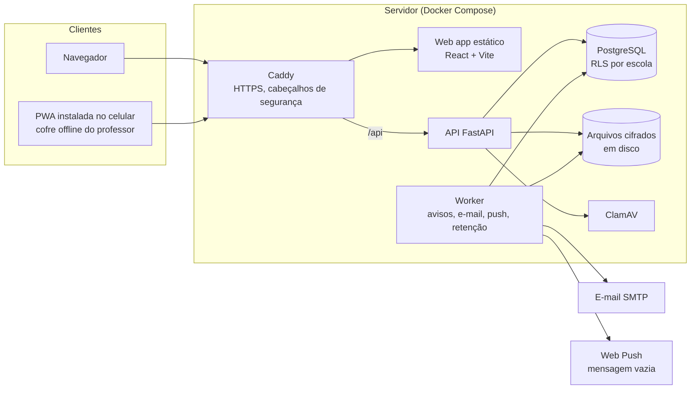

# Arquitetura

Uma aplicação web única, instalável no celular (PWA), falando com uma API. Simples de rodar num servidor pequeno.
As escolhas e o porquê estão nos ADRs [0001](../decisoes/0001-stack.md), [0002](../decisoes/0002-multiescola.md)
e [0003](../decisoes/0003-pwa-primeiro.md).



## Componentes

| Componente | Tecnologia | Papel |
|---|---|---|
| **Web app** | React 19, Vite, TypeScript, TanStack Query, `vite-plugin-pwa` | Todas as telas; instalável; o professor lança notas e chamada offline (cofre cifrado) |
| **API** | Python 3.13, FastAPI, Pydantic, SQLAlchemy 2, Alembic | Regras de negócio, permissões, cálculo de médias, direitos do titular |
| **Banco** | PostgreSQL 17 com Row-Level Security | Dados de todas as escolas, isolados por `escola_id` |
| **Worker** | `python -m app.cli notificar` (a cada minuto) | Avisos agendados, e-mails, push, retenção e apagamento de desligados |
| **Arquivos** | Disco cifrado (AES-GCM), atrás de uma interface ([ADR 0004](../decisoes/armazenamento-de-arquivos.md)) | Provas, anexos; acesso só por link assinado; S3 compatível fica para depois do piloto |
| **Antivírus** | ClamAV | Verifica todo envio; obrigatório em produção |
| **PDF** | Gerador próprio, sem biblioteca ([ADR 0005](../decisoes/pdf-proprio.md)) | Histórico escolar |
| **Proxy** | Caddy | HTTPS automático, HSTS, CSP, compressão, log sem dado pessoal |

## Monorepo

```text
caderneta/
├── api/          # FastAPI, migrações, testes (pytest)
├── web/          # React PWA, testes (Vitest) e scripts de screenshots e e2e offline
├── deploy/       # produção: imagens, Docker Compose, Caddyfile, .env de exemplo, smoke e verificação
├── infra/        # desenvolvimento (Postgres, Mailpit), papéis do banco e scripts de backup
├── scripts/      # licenças, tradução, fixação, notas de versão, relatório de migrations, pacote jurídico
├── .lgpd/        # mapa de dados, ROPA, RIPD, LIAs, plano de incidentes, pacote para o advogado
├── website/      # esta documentação (Docusaurus, português e inglês)
└── .github/      # CI (lint, testes com cobertura, auditorias, SBOM, imagens, release, doc), Dependabot, relatório de migrations
```

## Princípios técnicos

- **Regras no servidor.** Médias, permissões e prazos são calculados na API e protegidos no banco; o front só exibe.
- **Motor de médias puro.** Uma função sem acesso a banco, com testes de tabela para cada regra de escola.
- **Leve no cliente.** Telas carregadas sob demanda; meta de menos de 200 KB de JavaScript inicial (gzip).
- **Offline onde importa.** Lançamento de notas e chamada funcionam sem conexão e sincronizam depois, com os dados cifrados no aparelho.
- **Privacidade por padrão.** E-mail e push sem conteúdo, só para adultos; dados mínimos no cache; retenção automática.
- **Um servidor basta.** O piloto roda numa VM pequena; crescer significa separar banco e arquivos, sem reescrever.
