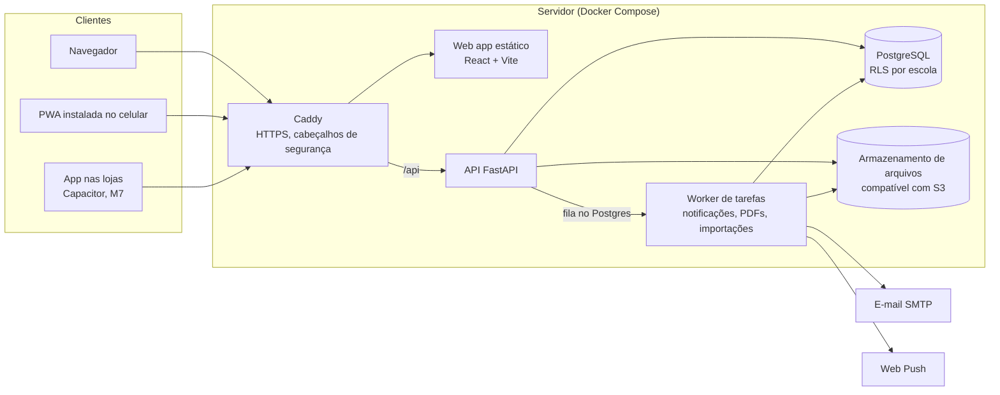

# Arquitetura

Uma aplicação web única, instalável no celular (PWA), falando com uma API. Simples de rodar num servidor pequeno.
As escolhas e o porquê estão nos ADRs [0001](../decisoes/0001-stack.md), [0002](../decisoes/0002-multiescola.md)
e [0003](../decisoes/0003-pwa-primeiro.md).



## Componentes

| Componente | Tecnologia | Papel |
|---|---|---|
| **Web app** | React 19, Vite, TypeScript, TanStack Query, `vite-plugin-pwa` | Todas as telas; instalável e com cache offline |
| **API** | Python 3.13, FastAPI, Pydantic, SQLAlchemy 2, Alembic | Regras de negócio, permissões, cálculo de médias |
| **Banco** | PostgreSQL 17 com Row-Level Security | Dados de todas as escolas, isolados por `escola_id` |
| **Fila de tarefas** | Procrastinate (fila em cima do Postgres) | Envio de notificações, geração de PDFs, importação CSV, sem precisar de Redis |
| **Arquivos** | Armazenamento compatível com S3 (MinIO no próprio servidor ou um provedor) | Provas, anexos, atestados; acesso só por URL assinada |
| **PDF** | WeasyPrint | Boletim, histórico escolar |
| **Proxy** | Caddy | HTTPS automático, HSTS, CSP, compressão |

## Monorepo

```text
caderneta/
├── api/          # FastAPI, migrações, testes (pytest)
├── web/          # React PWA, testes (Vitest + Playwright)
├── infra/        # docker-compose (dev e produção), Caddyfile, backups
├── website/      # esta documentação (Docusaurus)
└── .github/      # CI: lint, testes, build, auditoria de dependências, deploy da doc
```

## Princípios técnicos

- **Regras no servidor.** Médias, permissões e prazos são calculados na API e protegidos no banco; o front só exibe.
- **Motor de médias puro.** Uma função sem acesso a banco, com testes de tabela para cada regra de escola.
- **Leve no cliente.** Meta de menos de 200 KB de JavaScript inicial (gzip); telas carregadas sob demanda.
- **Offline onde importa.** Lançamento de notas e chamada funcionam sem conexão e sincronizam depois.
- **Um servidor basta.** O piloto roda numa VM pequena; crescer significa separar banco e arquivos, sem reescrever.
