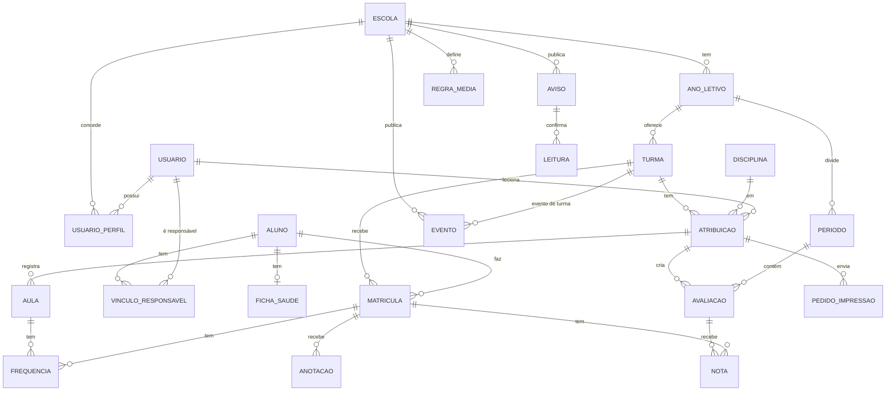

# Modelo de dados

Modelo que evolui a cada marco (o mapa de dados completo, com base legal e retenção, está em `.lgpd/data-map.md`). Todas as tabelas de dados escolares têm `escola_id` e são protegidas por
Row-Level Security (ver [ADR 0002](../decisoes/0002-multiescola.md)).

## Entidades principais

| Entidade | Campos-chave | Observações |
|---|---|---|
| `escola` | nome, CNPJ, fuso, configurações | Uma linha por escola cliente |
| `usuario` | e-mail, nome, senha (Argon2id), 2FA | Um usuário pode ter perfis em várias escolas |
| `usuario_perfil` | usuario, escola, papel (`admin`, `coordenacao`, `professor`, `responsavel`, `aluno`) | Base da autorização |
| `ano_letivo` / `periodo` | ano, datas, tipo (bimestre/trimestre), status (aberto/fechado) | Período fechado trava notas |
| `turma` / `disciplina` / `atribuicao` | série, turno; professor × turma × disciplina | Atribuição define o que o professor acessa |
| `aluno` | nome, sobrenome, nome social, nascimento, RA, situação | Dados de identificação |
| `ficha_saude` | alergias, medicamentos, condições, alerta resumido | **Criptografada**; leitura auditada |
| `vinculo_responsavel` | aluno, usuário, tipo, pode_buscar, recebe_avisos, emergencia, restrito | Muitos-para-muitos |
| `matricula` | aluno, turma, ano, situação final | Âncora do histórico |
| `regra_media` | tipo, pesos dos períodos, recuperação, arredondamento, média mínima, escala | Versionada por ano letivo |
| `avaliacao` / `nota` | peso, nota máxima, publicada; valor, status (normal, dispensada, falta justificada) | Alterações auditadas |
| `aula` / `frequencia` | data, quantidade; presente, falta, justificada, atraso | |
| `evento` | escopo (`escola` ou `turma`), tipo, início/fim, sem_aula | |
| `aviso` / `mensagem` / `leitura` | público-alvo, importante, agendamento; conversa; quem leu e quando | |
| `pedido_impressao` | arquivo, turmas, cópias, opções, status, prazo | |
| `anotacao` | tipo, visibilidade, versão, autor | Nunca apagada, só versionada |
| `auditoria` | quem, o quê, quando, IP, antes/depois | Só inserção; sem update/delete |
| `aviso` / `autorizacao` / `conversa` / `mensagem` | público, agendamento, ciente; resposta por aluno; texto e anexos | Leitura e respostas registradas; retenção de anexos |
| `notificacao` / `push_inscricao` | texto curto sem conteúdo sensível; endereço do aparelho | Apagadas por prazo; push só de adultos |
| `arquivo` | metadados; o conteúdo fica cifrado em disco | Link assinado; antivírus no envio |
| `historico_emitido` | aluno, quem emitiu, código, hash | Conferência pública devolve só as iniciais |
| `pedido_titular` | tipo, canal, prazo de 15 dias, resposta | Prova de atendimento, guardada 5 anos |
| `aceite_legal` | usuário, texto, versão, data | Ciência da política e dos termos |
| `limite_taxa` | hash do IP ou e-mail, contagem, janela | Apagado em 2 dias |
| `registro_operacao` | backups e testes de restauração: data, nome do arquivo, tamanho (da instalação, sem escola e sem dado pessoal) | Sem dado pessoal; uma linha por execução |

Médias **não são armazenadas**: são calculadas a partir das notas e da regra a cada consulta (`api/app/medias.py`).
No M2 isso é rápido o bastante; um cache só entra se o piloto mostrar necessidade.

Na `frequencia`, só ausências, faltas justificadas e atrasos são gravados: sem linha significa presente.
