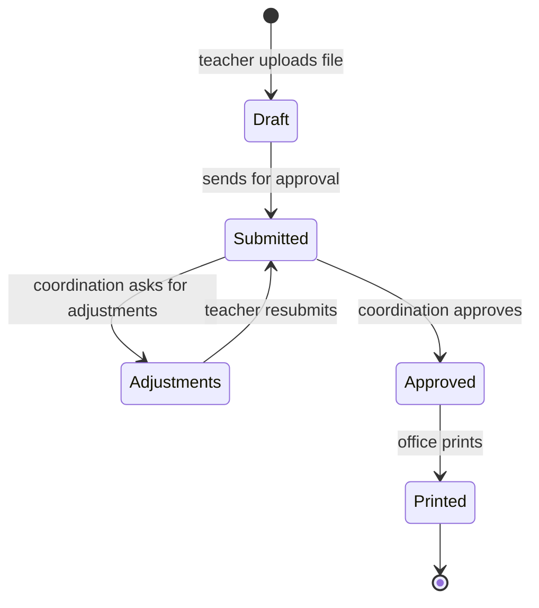

# Exams, assignments and print queue

The teacher uploads the exam or assignment file; the school receives it in a queue organized by exam date.

## Flow

Coordination approval is optional: the school can turn it off and send straight to the print queue.

## Data in each request

- File (PDF recommended; DOCX accepted and converted to PDF for faithful printing)
- Class(es), subject, exam date
- **Copies**: calculated from the number of active students in the class + a configurable spare; editable
- Double-sided, color or black-and-white, staple
- Adapted version (e.g., enlarged font) for students with specific needs
- Deadline: the school sets the minimum lead time (e.g., 48 h before the exam)

## Security

Exams are confidential material until they are taken:

- only the author teacher, coordination and the office access the file;
- downloads through a temporary signed link, recorded in the audit log;
- students and guardians never see the file, unless the teacher publishes it after the exam (e.g., the answer key).

## Assignments

The same flow serves **assignments and exercise lists**; for these the teacher can also publish the statement
to the class, which appears on the calendar with the due date.

## What already works (M5)

**Exams** screen (teachers, coordination and principal's office/secretariat) and **Materials** (families and students).

- **New request:** the teacher uploads a **PDF or DOCX** (up to 15 MB), picks the type (exam, assignment or list), date, **one or more classes**
  (the same file generates one request per class) and print options. They can attach an **adapted version** (e.g., enlarged font) with its own
  number of copies. It starts as a **draft**.
- **Calculated copies:** active students of the class in the open school year + the school's spare (default 2). The teacher sees the math and can edit;
  the office can also adjust until printing. The request stores the calculated value next to the final value.
- **Flow:** draft → under review → (adjustments ↔ under review) → in the queue → printed. **Who approves:** principal's office or coordination, who also ask for
  adjustments with a mandatory comment. **Who prints:** only the principal's office/secretariat (admin role). Each step notifies whoever needs to act.
- **School rules** (principal's office): require approval or not (without it, submitting goes straight to the queue), spare copies and **minimum lead
  time** in days. A request outside the lead time is blocked for the teacher and marked "outside lead time"; the principal's office can grant an exception.
- **Print queue:** filter by status and by exam period, ordered by date, with the total of copies already approved.
- **Confidentiality:** the file only opens for the author, coordination and the principal's office. Families and students **do not see the request** until the teacher
  **publishes** it. An **exam can only be published from the exam date on** (answer key, for example). Assignments and lists can be published
  after approval and start appearing on the [Calendar](./calendario.md) with the due date. Recipients see only the main file,
  never the adapted version.
- **Download:** signed link valid for 5 minutes, bound to the user. The API checks access again on the spot and records **`pedido.baixar`** in the
  audit log. There is no permanent file URL.
- **Encrypted at rest:** see [ADR 0004](../decisoes/armazenamento-de-arquivos.md).

### File security

- **Antivirus** (ClamAV) on every upload, failing closed, mandatory in production.
- **DOCX is converted to PDF** on the server (isolated LibreOffice), so printing comes out faithful and only the PDF is stored.
- **Retention:** requests are deleted 365 days after the exam date and stalled drafts after 90 days.
- Details in [ADR 0004](../decisoes/armazenamento-de-arquivos.md).

Left for later: S3-compatible storage (M9).

## Acceptance criteria (M5)

- [x] Upload with type, content and size verification
- [x] Status flow with optional approval and comments
- [x] Print queue filterable by date, with calculated copies
- [x] Download through a signed, audited URL
