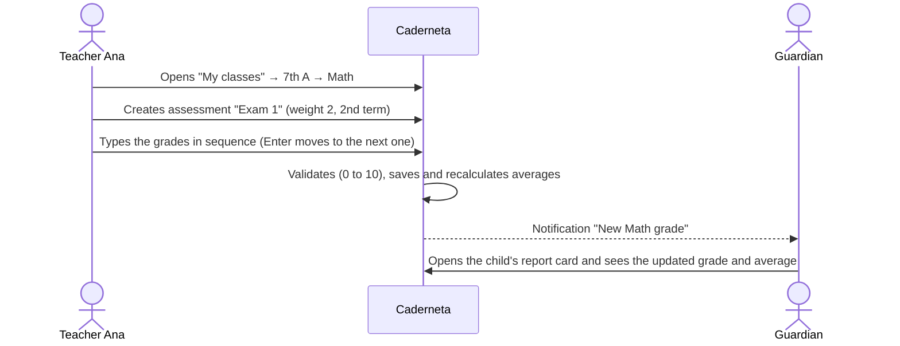

# User journeys

The journeys below guide the screen design. Each one should be possible in a few taps on the phone.

## Teacher Ana enters the exam grades

## The office prints the week's exams

1. Coordination approves the exam uploaded by the teacher.
2. The office opens the **Print queue**, filtered by exam date.
3. Each item shows class, number of copies (calculated from the number of students + spare), double-sided and deadline.
4. When printed, it is marked **Printed**; the teacher sees the status change.

## A parent follows their child

1. Receives an invitation by e-mail or WhatsApp with a link and creates a password.
2. On the home screen sees, for each child: latest grades, term averages, absences, upcoming events and unread notices.
3. Opens an important notice and taps **Acknowledged**.
4. Replies to a message from the teacher.

## The school publishes the year's calendar

1. When the school year is created, Caderneta already suggests the **national holidays**.
2. The school adds municipal holidays, recesses, parent meetings, celebrations and days off.
3. All classes see the general calendar; teachers add events only for their own classes.

## Year rollover

1. The school creates the new school year and the new classes.
2. Uses **Bulk re-enrollment**: picks the source class, marks passed/held back and the destination class.
3. The history (final grades, attendance, notes) is kept and visible to the new teachers according to permissions.
