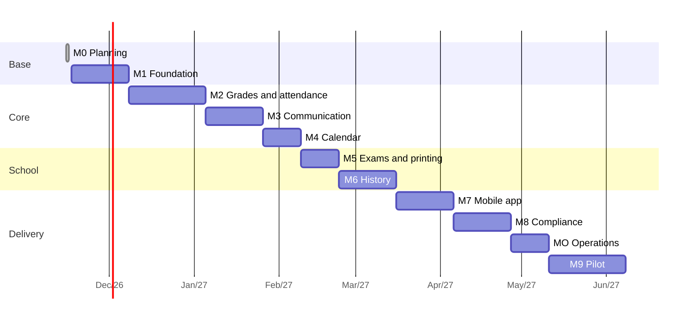

# Roadmap

Development is split into milestones. Each milestone ends with something **usable** and demonstrable, with screenshots
added to the feature pages.

| Milestone | Goal | Status |
|---|---|---|
| **M0: Planning** | Vision, roles, features, architecture, data model, security, documentation | ✅ Done |
| **M1: Foundation** | Monorepo, CI, login and roles, school/classes/subjects, student and guardian registration, CSV import, invitations | ✅ Done |
| **M2: Grades, averages and attendance** | Assessments, entry grid, configurable average engine, report card, roll call, term closing | ✅ Done |
| **M3: Communication** | School and class notices, individual messages, "acknowledged", authorizations, notifications, e-mail and push | ✅ Done |
| **M4: Calendar** | School and class calendar, national holidays, days off, iCal | ✅ Done |
| **M5: Exams and printing** | Upload, approval, print queue with calculated copies, assignments | ✅ Done |
| **M6: History and notes** | Bulk re-enrollment, timeline, versioned notes, school history as PDF | ✅ Done |
| **M7: Mobile app** | Refined PWA, offline for grades and roll call (app stores left for after the pilot) | ✅ Done |
| **M8: Compliance and security** | General review of security, licenses and compliance with the LGPD and applicable law, with legal validation | Code and documentation ready; the legal opinion and the penetration test are missing |
| **MO: Operations and maintenance** | Supply chain, repository files, versions and What's new in the app, operations warnings, migration and coverage tests, test-data tools (done before the pilot) | In progress |
| **M9: Pilot** | Production deployment, backups, pilot with one school (only starts with M8 approved) | Being prepared |

The dates are estimates to guide the order; the real pace adjusts the chart at each milestone.

This documentation is available in **Portuguese and English** (language switcher at the top). The legal texts and the compliance artifacts stay in Portuguese, because they apply Brazilian law.

## M1: Foundation (done)

Goal: a school can register, set up classes and invite teachers and families.
See [Access and invitations](./funcionalidades/acesso-e-convites.md), [School and classes](./funcionalidades/escola-e-turmas.md)
and [Student registration](./funcionalidades/cadastro-de-alunos.md).

- [x] Monorepo `api/`, `web/`, `infra/`; development Docker Compose with Postgres and Mailpit (MinIO comes in M5, together with the files)
- [x] CI: lint, typecheck, tests, `pip-audit`/`npm audit`, documentation build
- [x] Login, secure session, 2FA for administrators, password recovery
- [x] Roles per school and role switching in the menu
- [x] RLS per school with isolation tests
- [x] School year, terms, classes, subjects and teacher assignments
- [x] Student file, guardian links, encrypted health file
- [x] CSV import with preview
- [x] Single-use link invitations
- [x] Demo data (fictitious school) for development and screenshots
- [x] Screenshots on the [Student registration](./funcionalidades/cadastro-de-alunos.md) and [Roles](./produto/perfis.md) pages

:::note M1 notes
- 31 API tests run against a real PostgreSQL with the application's restricted role, so per-school isolation (RLS)
  is genuinely tested, including directly on the database.
- A bug found in manual tests: in current FastAPI, the commit of `yield` dependencies ran **after** the response
  went out, and the browser sometimes called `/auth/me` before the session existed. Fixed with
  `Depends(get_db, scope="function")` and protected by a regression test.
- Initial JavaScript of the web app: about 100 KB (gzip), half of the 200 KB goal.
:::

## M2: Grades, averages and attendance (done)

See [Grades and averages](./funcionalidades/notas-e-medias.md) and [Attendance](./funcionalidades/frequencia.md).

- [x] Assessments with weight and term; entry grid with keyboard and autosave
- [x] Average engine configurable per school, with table tests for each rule
- [x] Report card for the student and the guardian, publishing controlled by the teacher
- [x] Roll call per class and attendance percentage
- [x] Term closing with a justified, audited correction
- [x] Report card for printing and PDF through the browser

:::note M2 notes
- 72 API tests (average engine in tables, gradebook permissions, closing, family report card, roll call,
  average rule and a test that requires RLS on every new school table).
- Found in manual tests and fixed: the report card showed "Failed" with the last term still open; now the final
  status only comes out with all terms closed. Student search started accepting the full name. On the phone,
  wide tables stretched the page; now they scroll inside the card, and the report card becomes cards per subject.
- Screenshots generated by `npm run screenshots` in `web/` (Playwright), from the demo school.
- Scope changes: absence alerts and new-grade notice move to M3 (notifications); blocking roll call on a day
  off moves to M4 (calendar); offline entry moves to M7; server-generated PDF is left for the school
  history of M6.
:::

## M3: Communication (done)

- [x] School and class notices, with scheduling (segment and group of classes are left for later)
- [x] Individual school/teacher ↔ family messages (PDF and image attachments, 3 per message, with antivirus and no EXIF)
- [x] "Acknowledged" and a reading panel for the sender
- [x] Reminder to those pending
- [x] Digital authorizations (field trip, early dismissal)
- [x] In-app notifications and e-mail with quiet hours, e-mail without content and for adults only
- [x] Push (PWA) without content, adults only, with device retention (M3.5)
- [x] Absence alerts (15% and 20%) and new published grade

## M8: Compliance and security

Goal: before any real school uses Caderneta, review everything involving **security, licenses and the law**.
Caderneta handles data about children and teenagers and health data, so being compliant is a launch
requirement, not a detail. The pilot (M9) **only starts with this milestone approved**.

Main reference: the [LGPD campaign of the Ministry of Development and Social Assistance](https://www.gov.br/mds/pt-br/acesso-a-informacao/governanca/integridade/campanhas/lgpd),
together with the text of Law no. 13,709/2018 and ANPD guidance.

### Order of work for M8

M8 is big, so it runs in stages, each with its own PR:

1. **M8.1 Code security ✅:** dependency audit (`pip-audit`, `npm audit`, SBOM), review of authentication, authorization and RLS, rate limits (T21), headers, OWASP Top 10/ASVS checklist and fixing whatever turns up
2. **M8.2 Data subject rights (art. 18) ✅:** request flow for access, correction, deletion and portability, with deadline and record (T1, T19, T20, T25)
3. **M8.3 Transparency ✅ (draft):** privacy policy and terms in plain language, recorded and versioned acknowledgement, DPO channel
4. **M8.4 Compliance documents ✅ (drafts):** ROPA and RIPD (drafts with the `lgpd-audit` skill, **human and legal review mandatory**), incident response plan
5. **M8.5 Safe operation ✅:** encrypted backups and restore test, key management, logs without personal data (T14, T24; part already foreseen for M9)
6. **Closing:** legal opinion attached, third-party pen test, approval criteria below

### How compliance is conducted

- **Method:** the `lgpd-audit` skill from the [goul4rt/lgpd-skills](https://github.com/goul4rt/lgpd-skills) repository (pipeline C, hybrid),
  with a mandatory pause for human and legal review on the ROPA, the RIPD, the privacy policy and communications to the ANPD.
- **Text of the laws:** checked in the [ctresb/leis](https://github.com/ctresb/leis) repository (LGPD, ECA Digital, Decree 12,880/2026, Marco Civil).
  The ANPD resolutions are not in it yet and must be checked against the official text.
- **Versioned artifacts** in [`.lgpd/`](https://github.com/EttoreCSenatore/caderneta/tree/main/.lgpd): `STATUS.md`, `data-map.md` and `gaps.md` (in Portuguese).
  The preliminary data map (M1 to M3.3) already exists; the prioritized gaps are in `gaps.md`.
- **Rule:** every PR that collects new personal data updates the data map and the gaps.

### LGPD and legal compliance

- [x] **Data mapping and ROPA**: map (A001 to A019) and ROPA in draft, with DPO and legal review pending. See [Compliance documents](./tecnico/documentos-de-conformidade.md)
- [ ] **Legal basis per purpose** (arts. 7 and 11): performance of the educational service, legal and school obligation, consent only where truly necessary
- [ ] **Data of children and teenagers** (art. 14): best interest, specific consent of a guardian when it is the basis, notice in clear language; also review the ECA Digital (Law no. 15,211/2025)
- [ ] **Health data** (sensitive): restricted purpose, minimal access, encryption and access trail, already implemented and to be reviewed
- [x] **RIPD** in draft (17 risks with a matrix and a preliminary ECA Digital assessment). Opinions and approval pending
- [x] **Data subject rights** (art. 18): download your own data instantly, requests for correction, deletion, portability and information with a protocol number and a 15-day deadline, a queue for the principal's office, logging of requests received outside the app. See [Data subject rights](./funcionalidades/direitos-do-titular.md). The opinion on internal notes is missing (T19)
- [x] **Leavers section** (maintainer's decision): a separate area for students and users who left, with a countdown, **notice before** deleting and a postpone option. See [Leavers](./funcionalidades/desligados.md). Confirming the minimum retention period of the school history with legal is missing
- [ ] **Retention and deletion**: periods per type of data, respecting the mandatory retention of the school history; disposal routine
- [x] **Data protection officer (DPO)**: the school enters name and e-mail, shown in the policy and in My data. Each school still has to appoint the person
- [ ] **Operators and sub-operators**: data processing agreements with the school and with providers (hosting, e-mail, push); international data transfer, if any, with a legal mechanism
- [x] **Incident response plan**: step by step, deadlines, communication templates, 5-year record and a containment tool (`revogar-sessoes`). The **drill** and the on-call names are missing (T33)
- [x] **Privacy policy and terms of use** in plain language, with acknowledgement recorded per version: see [Privacy and terms](./funcionalidades/privacidade-e-termos.md). **Draft**: publish only after the legal opinion
- [x] **Cookie notice**: not needed (only the essential session cookie); the policy explains this and the offline-mode storage
- [ ] **Accessibility and consumer law**: review what the law requires depending on the platform's offering model (contract with schools)
- [x] **Lawyer package**: a single-document generator per installation (`scripts/gerar-pacote-juridico.py`), with 14 questions, installation sheet, opinion template and all annexes. See [Lawyer package](./tecnico/pacote-juridico.md). Own legal texts per installation (`CADERNETA_LEGAL_DIR`)
- [ ] **Legal review**: a lawyer specialized in data protection validates the documents above, **at each installation**. The technical documentation guides, but **does not replace a legal opinion**

### Security

- [x] **M8.1** code security review (authentication, authorization, RLS, uploads, injection, CSRF, headers): see the [review](./tecnico/revisao-de-seguranca.md)
- [ ] **Penetration test** by a third party
- [x] Dependencies: `pip-audit` and `npm audit` in CI and a CycloneDX SBOM generated on every change. The update policy (review cadence) is missing
- [x] Keys: data key **rotation** (`rotacionar-chave`, reads with the old one and writes with the new one), one key per environment, encryption at rest (AES-GCM) and in transit (TLS at deployment). See [Backups, keys and logs](./tecnico/backups-chaves-e-logs.md)
- [x] **Encrypted backups** (AES-256), a **restore test** that checks the keys, 35-day expiry and a restore procedure that re-applies retention. Running on real hosting is missing (M9)
- [x] Logs without personal data: no query string or URL secrets in the access log. [ ] Monitoring and alerts are left for the deployment (M9)
- [ ] Review of permissions per role (principle of least privilege) and of support access
- [x] Rate limiting (login, password recovery, invitations, history verification), single-use 2FA code, change password and sign out of all devices
- [ ] Decide 2FA for teachers, a weak-password list and 2FA backup codes
- [x] OWASP Top 10 checked and recorded in the [review](./tecnico/revisao-de-seguranca.md)
- [ ] OWASP ASVS level 2 complete (the pen test covers the rest)

### Licenses

- [x] **Code license: AGPL-3.0-or-later** (maintainer's decision), with `LICENSE`, metadata in the manifests and the [license page](./licenca.md)
- [x] **Documentation and screenshots license: CC BY-SA 4.0**, with fictitious data in the demos ([`LICENSE-DOCS.md`](https://github.com/EttoreCSenatore/caderneta/blob/main/LICENSE-DOCS.md))
- [x] **Dependency license audit** (npm and Python): `scripts/auditar-licencas.py` in CI and a generated `THIRD_PARTY_NOTICES.md`
- [ ] Licenses of fonts, icons, images and logo
- [ ] "Caderneta" trademark: registration with INPI is optional (will not be done now); only a quick, free look at the INPI database before the pilot, changing the name if there is a conflict

### Approval criteria

- All the items above completed or with a decision and justification recorded
- Legal opinion attached and corrections applied
- Pen test with no critical or high finding left
- Public documents (privacy, terms) published

:::note Continuous compliance, not only in M8
Each earlier milestone must **update the data inventory and the RIPD** when it collects new data, and each PR is reviewed for
minimal access, audit and retention. M8 is the general review, not the first moment the law is considered.
:::

## M4: Calendar (done)

See [Calendar](./funcionalidades/calendario.md).

- [x] School and class events, with permissions per role
- [x] Statutory national holidays, confirmed by the school; movable dates calculated
- [x] Days off and holidays block roll call and notify families
- [x] Dated assessments appear on the class calendar
- [x] List, month and week views
- [x] iCal subscription by secret, revocable link

## M5: Exams and printing (done)

See [Exams and printing](./funcionalidades/provas-e-impressao.md) and [ADR 0004](./decisoes/armazenamento-de-arquivos.md).

- [x] Upload validated by content, encrypted at rest
- [x] Flow with optional approval, adjustments and comments; configurable minimum lead time
- [x] Print queue with calculated copies (active students + spare) and adapted version
- [x] Confidentiality until publication; an exam is only published from the exam date; assignments on the calendar
- [x] 5-minute signed-link download, audited
- [x] Antivirus (ClamAV, fail closed), DOCX to PDF conversion, message attachments without EXIF and file retention

## M6: History and notes (done)

See [History and notes](./funcionalidades/historico-e-anotacoes.md).

- [x] M6.1: new-year classes, bulk re-enrollment with the report card's suggestion, year closing, timeline
- [x] Access to students and classes only through the open school year (privacy at rollover)
- [x] M6.2: versioned notes (pedagogical, incident, praise, reserved) with visibility by type, audit of the reserved one and deletion 30 days after removal
- [x] M6.3: school history as a PDF (in-house generator, [ADR 0005](./decisoes/pdf-proprio.md)), recorded issuance and public code verification

## M7: Mobile app (done)

See [Offline mode](./funcionalidades/offline.md).

- [x] M7.1: offline grades and roll call for teachers, with an encrypted vault on the device, send queue, erasure on sign-out and after 7 days without a connection
- [x] Fix: signing out hung when the browser had no service worker
- [x] M7.2 PWA: the app opens without internet (identity, classes and gradebooks come from the encrypted vault), install invitation (Android/desktop and an iPhone tip), shortcuts, dark theme in the bar, end-to-end test with Chromium and the internet cut (`npm run e2e:offline`)
- [ ] Test on real devices (Android and iPhone) with the PWA installed, including push: **moves to M9** (pilot checklist)
- [x] Capacitor/app stores: **maintainer's decision (2026-11-17): out of the pilot.** The installed PWA is enough; stores cost a paid account, review, and they reopen the privacy analysis. Re-evaluate after the pilot if a school asks

## MO: Operations and maintenance (before the pilot)

Ideas adapted from another open-source management system, [Kaladrius](https://github.com/facchini-miguel/kaladrius) (clinics, Apache 2.0). The focus is keeping Caderneta secure and easy to update once it is in use. Each step is one PR, in the order below.

- [x] **MO.1 Supply chain** ([#37](https://github.com/EttoreCSenatore/caderneta/issues/37)): Dependabot for Python, both npm projects, GitHub Actions and Docker images, with a 7-day wait for new versions (security fixes come right away) and grouped PRs; Actions pinned to a commit; images pinned by digest, with a test requiring the same Postgres in development and production
- [x] **MO.2 Repository files** ([#38](https://github.com/EttoreCSenatore/caderneta/issues/38)): `SECURITY.md` (how to report a flaw), `CONTRIBUTING.md`, `CODE_OF_CONDUCT.md`, `CODEOWNERS` and `NOTICE` (the name and logo are not part of the license)
- [x] **MO.3 Versions and What's new** ([#39](https://github.com/EttoreCSenatore/caderneta/issues/39)): one `releases.yaml` as the single source; version in the footer and in `/api/saude`; What's new page in the app and a "new version, see what changed" notice; GitHub tag and release generated from the same file; versioning page in the documentation
- [x] **MO.4 Operations warnings** ([#40](https://github.com/EttoreCSenatore/caderneta/issues/40)): every backup is recorded in the database; the school management and the IT person see a banner when the last backup is older than 26 hours or when the server's disk or memory reach the limit (covers part of gap T35)
- [ ] **MO.5 Migrations** ([#41](https://github.com/EttoreCSenatore/caderneta/issues/41)): CI test that applies, reverts and applies again; a report on the PR with the SQL of each new migration and the operations that delete data
- [ ] **MO.6 Test data** ([#42](https://github.com/EttoreCSenatore/caderneta/issues/42)): a command that deletes only the demo data (never a real school) and a command that simulates the current week's activity (lessons, roll calls, grades), so the demo does not look idle
- [ ] **MO.7 Test coverage** ([#43](https://github.com/EttoreCSenatore/caderneta/issues/43)): measure API and web coverage and fail CI below a target set from today's number
- [ ] **MO.8 Public demo** ([#44](https://github.com/EttoreCSenatore/caderneta/issues/44)): a page with the accounts for each role and the made-up data recreated daily; **depends on hosting** (done together with M9)

## M9: Pilot (being prepared)

See [Deployment](./tecnico/implantacao.md) and the [Pilot plan](./piloto.md). It only starts with **real data** after M8 is approved.

- [x] Single-machine deployment recipe: `deploy/` with images (API and site), production Docker Compose, Caddy with automatic HTTPS and security headers, example `.env`, secret generator
- [x] Smoke test (`deploy/smoke.sh`), periodic check (`verificar.sh`: site, late backup, disk, database, stopped service, alerting the on-call person) and an example schedule (backup and restore)
- [x] Pilot plan: entry gate (go/no-go), phases, import, support by severity, metrics without personal data, rollback plan and closing
- [x] Full stack **tested locally** with test HTTPS
- [ ] **Choose the hosting** and the e-mail provider (O8) and fill in the installation sheet
- [ ] Run the deployment, backups and restore test **on real hosting**
- [ ] Test on **real devices** (Android and iPhone): install, open without internet, enter offline, push (needs HTTPS and VAPID keys)
- [ ] Lawyer's opinion, penetration test, on-call person and drill (M8 entry gate)
- [ ] Choose the pilot school and run the plan's phases

## Leavers retention (done before M8)

- [x] Deletion of a student's complementary data and anonymization of accounts, with per-school periods, notice beforehand and postponement
- [ ] Legal opinion on the default periods (365 and 180 days) and on the minimum retention period of the history

## After the pilot (ideas)

- Class timetable and teacher substitutions
- Homework with online submission
- Reports for the principal's office (performance per class, students at risk)
- WhatsApp Business integration for notifications
- Enrollment portal for new students
- English and Spanish versions of the interface
- Linux package (`apt install caderneta`, with on-screen questions and daily backup), for schools without an IT team
- Anonymize a copy of a real school for testing: only with the lawyer's approval, since it is minors' data
