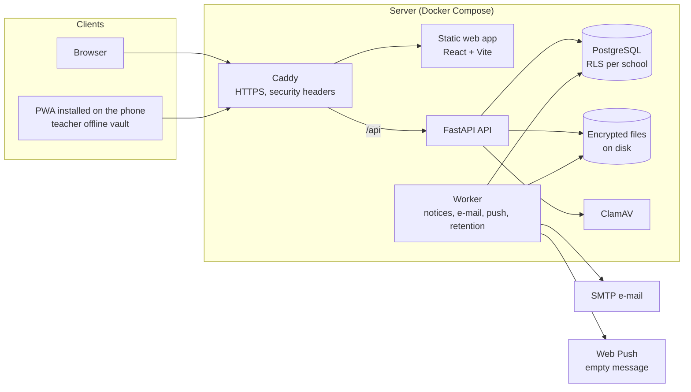

# Architecture

A single web application, installable on the phone (PWA), talking to an API. Simple to run on a small server.
The choices and the reasons are in ADRs [0001](../decisoes/0001-stack.md), [0002](../decisoes/0002-multiescola.md)
and [0003](../decisoes/0003-pwa-primeiro.md).



## Components

| Component | Technology | Role |
|---|---|---|
| **Web app** | React 19, Vite, TypeScript, TanStack Query, `vite-plugin-pwa` | All the screens; installable; teachers enter grades and roll call offline (encrypted vault) |
| **API** | Python 3.13, FastAPI, Pydantic, SQLAlchemy 2, Alembic | Business rules, permissions, average calculation, data subject rights |
| **Database** | PostgreSQL 17 with Row-Level Security | Data of all schools, isolated by `escola_id` |
| **Worker** | `python -m app.cli notificar` (every minute) | Scheduled notices, e-mails, push, retention and deletion of leavers |
| **Files** | Encrypted disk (AES-GCM), behind an interface ([ADR 0004](../decisoes/armazenamento-de-arquivos.md)) | Exams, attachments; access only through signed link; S3-compatible left for after the pilot |
| **Antivirus** | ClamAV | Scans every upload; mandatory in production |
| **PDF** | In-house generator, no library ([ADR 0005](../decisoes/pdf-proprio.md)) | School history |
| **Proxy** | Caddy | Automatic HTTPS, HSTS, CSP, compression, log without personal data |

## Monorepo

```text
caderneta/
├── api/          # FastAPI, migrations, tests (pytest)
├── web/          # React PWA, tests (Vitest) and screenshot and offline e2e scripts
├── deploy/       # production: images, Docker Compose, Caddyfile, example .env, smoke test and checks
├── infra/        # development (Postgres, Mailpit), database roles and backup scripts
├── scripts/      # license audit, legal package generator
├── .lgpd/        # data map, ROPA, RIPD, LIAs, incident plan, lawyer package (in Portuguese)
├── website/      # this documentation (Docusaurus, Portuguese and English)
└── .github/      # CI: lint, tests, build, dependency and license audit, SBOM, images, docs deploy
```

## Technical principles

- **Rules on the server.** Averages, permissions and deadlines are computed in the API and protected in the database; the front end only displays.
- **Pure average engine.** A function with no database access, with table tests for each school rule.
- **Light on the client.** Screens loaded on demand; goal of under 200 KB of initial JavaScript (gzip).
- **Offline where it matters.** Entering grades and roll call works without a connection and syncs later, with the data encrypted on the device.
- **Privacy by default.** E-mail and push without content, adults only; minimal data in the cache; automatic retention.
- **One server is enough.** The pilot runs on a small VM; growing means separating the database and files, without rewriting.
