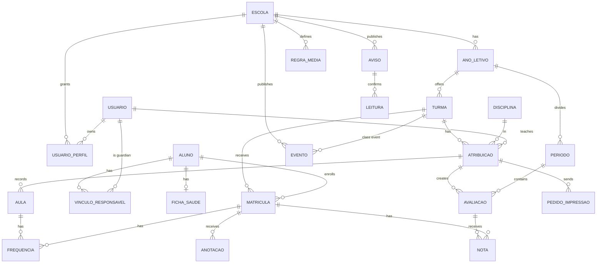

# Data model

A model that evolves with each milestone (the complete data map, with legal basis and retention, is in `.lgpd/data-map.md`). All school-data tables have `escola_id` and are protected by
Row-Level Security (see [ADR 0002](../decisoes/0002-multiescola.md)).

## Main entities

| Entity | Key fields | Notes |
|---|---|---|
| `escola` | name, CNPJ, time zone, settings | One row per client school |
| `usuario` | e-mail, name, password (Argon2id), 2FA | A user can have roles at several schools |
| `usuario_perfil` | user, school, role (`admin`, `coordenacao`, `professor`, `responsavel`, `aluno`) | Basis of authorization |
| `ano_letivo` / `periodo` | year, dates, type (two-month/three-month), status (open/closed) | A closed term locks grades |
| `turma` / `disciplina` / `atribuicao` | grade, shift; teacher × class × subject | The assignment defines what the teacher can access |
| `aluno` | name, surname, social name, birth date, RA, status | Identification data |
| `ficha_saude` | allergies, medication, conditions, summary alert | **Encrypted**; reads audited |
| `vinculo_responsavel` | student, user, type, can_pick_up, receives_notices, emergency, restricted | Many-to-many |
| `matricula` | student, class, year, final status | Anchor of the history |
| `regra_media` | type, term weights, recovery, rounding, minimum average, scale | Versioned per school year |
| `avaliacao` / `nota` | weight, maximum grade, published; value, status (normal, excused, excused absence) | Changes audited |
| `aula` / `frequencia` | date, quantity; present, absent, excused, late | |
| `evento` | scope (`escola` or `turma`), type, start/end, no_class | |
| `aviso` / `mensagem` / `leitura` | audience, important, scheduling; conversation; who read and when | |
| `pedido_impressao` | file, classes, copies, options, status, deadline | |
| `anotacao` | type, visibility, version, author | Never deleted, only versioned |
| `auditoria` | who, what, when, IP, before/after | Insert only; no update/delete |
| `aviso` / `autorizacao` / `conversa` / `mensagem` | audience, scheduling, acknowledgement; answer per student; text and attachments | Reads and answers recorded; attachment retention |
| `notificacao` / `push_inscricao` | short text without sensitive content; device address | Deleted by period; push for adults only |
| `arquivo` | metadata; the content stays encrypted on disk | Signed link; antivirus on upload |
| `historico_emitido` | student, who issued, code, hash | Public verification returns only initials |
| `pedido_titular` | type, channel, 15-day deadline, answer | Proof of compliance, kept 5 years |
| `aceite_legal` | user, text, version, date | Acknowledgement of the policy and terms |
| `limite_taxa` | hash of IP or e-mail, count, window | Deleted in 2 days |

Averages **are not stored**: they are calculated from the grades and the rule on every query (`api/app/medias.py`).
In M2 this is fast enough; a cache only comes in if the pilot shows a need.

In `frequencia`, only absences, excused absences and lateness are stored: no row means present.
